# 🗺️ Việt Nam Đất Nước Ta Ơi (`LIVE-BANDO`)

  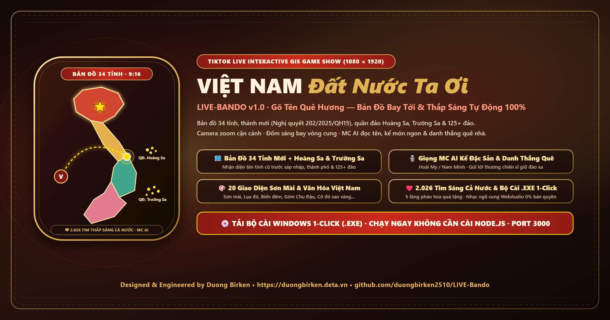
    
  <h3>
    💿 👉 <a href="https://github.com/duongbirken2510/LIVE-Bando/releases/latest/download/Viet-Nam-Dat-Nuoc-Ta-Oi-Setup-v1.0.exe"><b>[TẢI NGAY BỘ CÀI ĐẶT WINDOWS 1-CLICK: Viet-Nam-Dat-Nuoc-Ta-Oi-Setup-v1.0.exe]</b></a> 👈
    &nbsp;·&nbsp;
    🎬 👉 <a href="./live-bando.mp4"><b>[XEM VIDEO QUAY PHÒNG LIVE THỰC TẾ (live-bando.mp4)]</b></a> 👈
  </h3>
  
<i>(Đã nhúng sẵn Node.js Runtime + System Tray Guardian v2 + Bản đồ 34 Tỉnh Thành &amp; Hoàng Sa - Trường Sa + 20 Giao Diện Sơn Mài + Giọng MC AI — Tải về nhấp đúp là tự tạo icon Desktop và chạy ngay trên cổng 4012, KHÔNG cần cài đặt Node.js!)</i>

> **Game Bản Đồ Việt Nam 34 Tỉnh Thành & Biển Đảo Tương Tác Thời Gian Thực Cho TikTok LIVE (`1080 × 1920`)**  
> Người xem gõ tên tỉnh, thành phố hoặc hòn đảo quê mình vào bình luận, bản đồ Việt Nam bay camera cận cảnh tới tỉnh đó, đốm sáng bay vòng cung thắp sáng tỉnh kèm Avatar và tên người gọi, MC AI đọc tên bạn ấy và nhắc 1–2 món ngon, danh thắng của quê nhà (hoặc gửi lời thương tới các anh chiến sĩ đang giữ đảo Hoàng Sa, Trường Sa).  
> **Tác giả:** **Duong Birken** — [https://duongbirken.deta.vn](https://duongbirken.deta.vn)  
> **Kho mã nguồn:** [https://github.com/duongbirken2510/LIVE-Bando](https://github.com/duongbirken2510/LIVE-Bando)  
> **Tải bộ cài đặt `.EXE` 1-Click:** [GitHub Releases v1.0.0](https://github.com/duongbirken2510/LIVE-Bando/releases/latest) · [`DOWNLOAD_APP.md`](./DOWNLOAD_APP.md)  
> **Video Demo Phòng LIVE Thực Tế (`1080 × 1920` · `60s` · Có Âm Thanh):** [`live-bando.mp4`](./live-bando.mp4)  
> **Cổng vận hành mặc định:** `http://localhost:4012` (Admin) · `http://lvh.me:4012/?view=stage` (Sân khấu TikTok LIVE Studio `1080 × 1920`)

---

## 🎬 Video Quay Trực Tiếp Phiên Livestream Thực Tế (`live-bando.mp4`)

  <a href="./live-bando.mp4">
    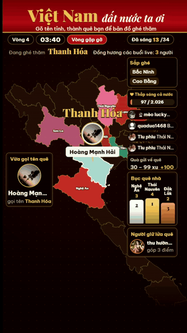
  </a>
  

    <i>▶️ Bấm vào ảnh động GIF phía trên hoặc mở trực tiếp file <a href="./live-bando.mp4"><b><code>live-bando.mp4</code></b></a> để xem video quay thực tế phiên livestream Việt Nam Đất Nước Ta Ơi (<code>1080 × 1920</code> · <code>30fps</code> · <code>60 giây</code> · Đầy đủ giọng MC AI kể đặc sản, danh thắng &amp; khán giả thật gọi tên quê hương).</i>
  

| 📍 Khán Giả Gọi Tên **Thanh Hóa** Trên Sóng LIVE | 🏔️ Camera Bay Tới **Cao Bằng** & Đốm Sáng Chạm Tỉnh | 🌴 Ghim Avatar Thực Tế Tại **Tây Ninh** & Đua Top Bục Quê Nhà |
| :---: | :---: | :---: |
| 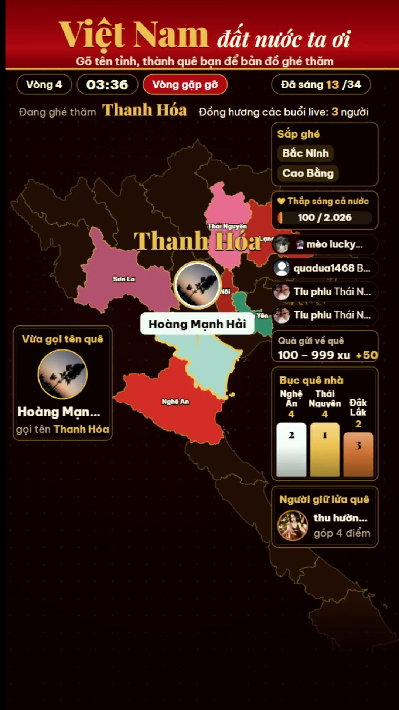 | 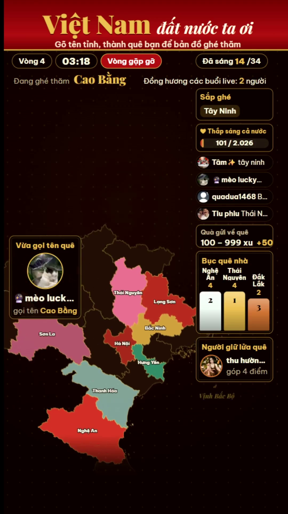 | 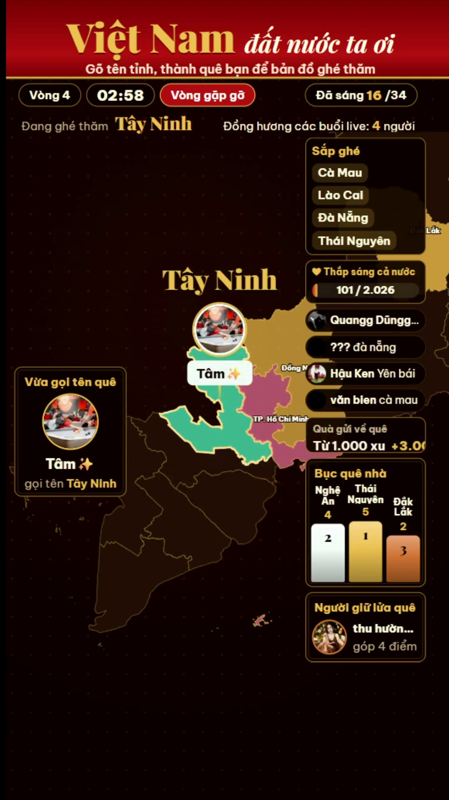 |

---

## ⚠️ Đọc trước khi dùng: lưu ý, cảnh báo và trách nhiệm

Game chia sẻ miễn phí, ai cũng lấy về dùng được. Trước khi dùng cho buổi live của mình, đọc kỹ mấy điều sau:

1. **Bản đồ là hình mô phỏng.** Hoàng Sa, Trường Sa được vẽ thu nhỏ, đặt gần bờ hơn thực tế cho vừa khung hình. Ranh giới 34 tỉnh, thành lấy từ bộ dữ liệu cộng đồng, không phải bản đồ chính thức của nhà nước. Trên màn hình đã có dòng ghi *"Hình ảnh mô phỏng, vẽ thu nhỏ, không theo tỷ lệ"*, đừng xoá dòng này. Ai sửa bản đồ thì phải giữ đủ Hoàng Sa, Trường Sa.
2. **Không dùng game để trao thưởng.** Game chỉ cộng điểm cho quê, không có giải thưởng. Nếu bạn tự đặt thêm thưởng tiền hay quà cho người đứng top hoặc tặng nhiều nhất, việc đó có thể bị coi là khuyến mại hoặc trò chơi có thưởng theo luật, phải làm thủ tục riêng, và bạn tự chịu trách nhiệm.
3. **Tiền quà là thu nhập của bạn.** Quà người xem tặng là thu nhập của người live. Việc kê khai, nộp thuế thì bạn tự tìm hiểu theo quy định hiện hành.
4. **Kết nối và giọng đọc dùng công cụ không chính thức.** Game nối vào phòng live và tạo giọng MC qua các công cụ bên ngoài, không phải công cụ chính thức của nền tảng hay của Microsoft, Google. Các công cụ này có thể ngừng chạy bất cứ lúc nào. Rủi ro với tài khoản của bạn (bị hạn chế, khoá tính năng) bạn tự cân nhắc.
5. **Bộ lọc từ tục không bắt được hết.** Game đã chặn tên và comment tục, MC không bao giờ đọc nguyên văn comment. Dù vậy người xem luôn nghĩ ra cách viết mới, nên chủ kênh vẫn phải tự để mắt và chịu trách nhiệm về nội dung buổi live của mình.
6. **Lời MC kể về các tỉnh** (món ngon, danh thắng) được soạn theo hiểu biết chung, có thể chưa chuẩn hết. Thấy chỗ nào sai thì sửa trong `src/game/provinceTalk.ts`.
7. **Dùng game là bạn tự chịu trách nhiệm.** Game được chia sẻ nguyên trạng, không kèm cam kết gì. Tác giả không chịu trách nhiệm về thiệt hại hay rắc rối pháp lý phát sinh khi bạn sử dụng. Mấy điều trên là tự tìm hiểu, không phải tư vấn pháp lý. Ai live với mục đích kinh doanh thì nên hỏi luật sư.

---

## 🖼️ Giao Diện Thực Tế (Trang Điều Khiển Admin & Sân Khấu `1080 × 1920`)

### 1. Trang Quản Trị Admin, Bảng Chọn 20 Giao Diện & Khung Xem Trước (`http://localhost:4012`)

  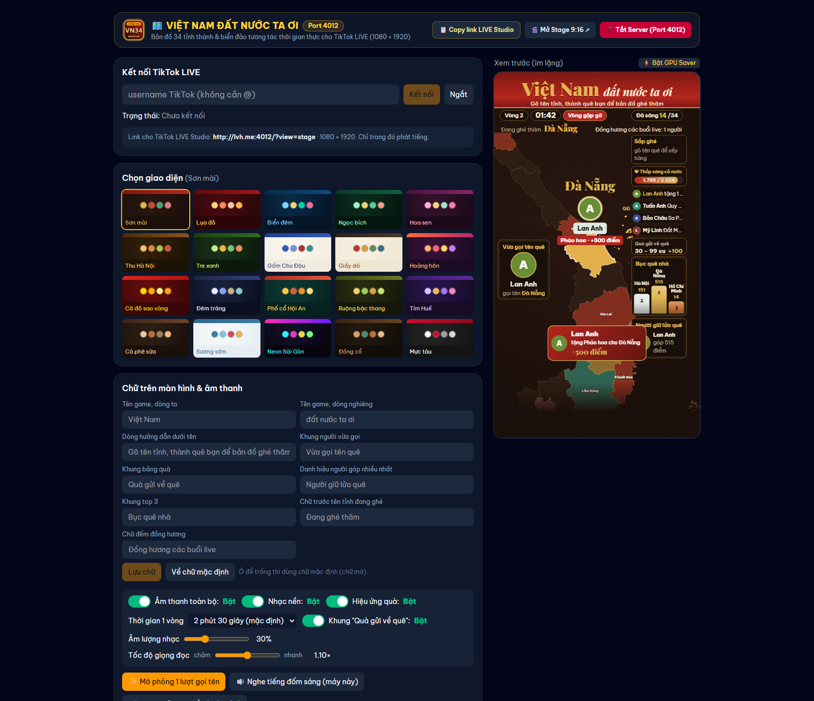

### 2. Sân Khấu Dọc Chuẩn TikTok LIVE Studio (`1080 × 1920` Vertical Stage)

| 🗺️ **Sơn Mài Toàn Cảnh 34 Tỉnh & Biển Đảo** | 📍 **Camera Zoom Cận Cảnh & Ghim Quê Hương** | ❤️ **2.026 Tim — Cả Nước Sáng Đèn!** | 🌙 **Giao Diện Biển Đêm & Tổng Kết Vòng** |
| :---: | :---: | :---: | :---: |
| 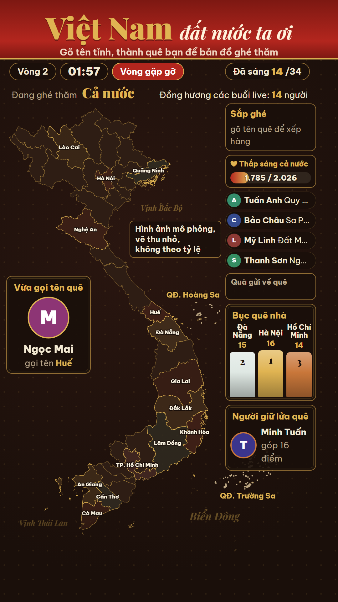 | 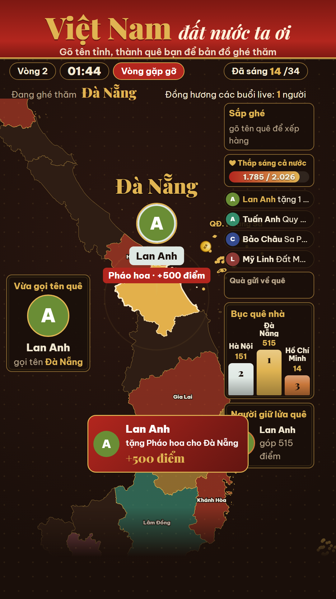 | 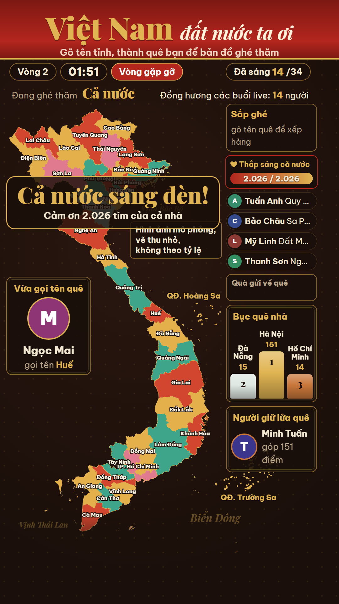 | 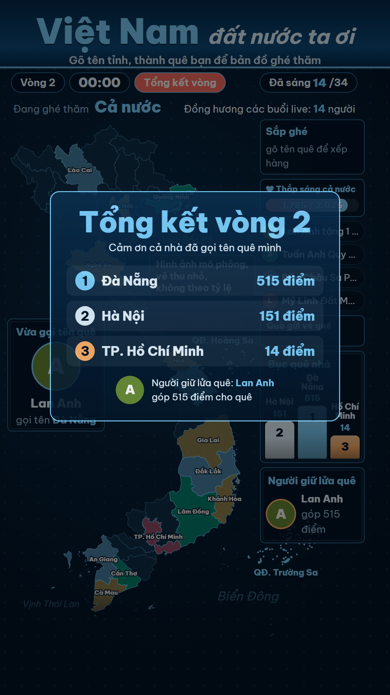 |

---

## 📚 Tài Liệu Chi Tiết Dự Án

| Tài liệu | Đường dẫn | Nội dung chính |
| :--- | :--- | :--- |
| 💿 **Tải Bộ Cài Đặt Windows 1-Click (`.EXE`)** | [**`DOWNLOAD_APP.md`**](./DOWNLOAD_APP.md) | Link tải trực tiếp `Viet-Nam-Dat-Nuoc-Ta-Oi-Setup-v1.0.exe` (tích hợp sẵn Node.js, System Tray Guardian v2, tự tạo biểu tượng Desktop) và `Viet-Nam-Dat-Nuoc-Ta-Oi.exe`. |
| 🗺️ **Hồ Sơ Giới Thiệu Sản Phẩm & Công Nghệ (10 Chương)** | [**`info/Introduce_VietNamDatNuocTaOi.md`**](./info/Introduce_VietNamDatNuocTaOi.md) | Định nghĩa sản phẩm, ma trận 8 nhóm tính năng, thuật toán nhận diện 34 tỉnh + tỉnh cũ + 125 đảo, kiến trúc D3-Geo & WebAudio chuyên sâu. |
| 📖 **Cẩm Nang Hướng Dẫn Sử Dụng Toàn Tập (A–Z · VI/EN)** | [**`docs/USER_GUIDE.md`**](./docs/USER_GUIDE.md) | Hướng dẫn cài đặt `.exe` 1-Click, chạy `.bat`, nhúng Browser Source `1080 × 1920` vào TikTok LIVE Studio, đổi 20 giao diện sơn mài và xử lý sự cố. |
| 🎬 **Video Bản Ghi Phòng LIVE Thực Tế (`.MP4`)** | [**`live-bando.mp4`**](./live-bando.mp4) | Video quay trực tiếp phiên LIVE thực tế (`1080 × 1920`, `60 giây`, đầy đủ giọng đọc MC AI kể đặc sản, danh thắng & khán giả TikTok bình luận gọi tên quê hương). |

---

## 🚀 Cài Đặt & Khởi Chạy Nhanh (`Port 4012`)

### Cách 1: Cài đặt bằng Bộ Cài `.EXE` 1-Click (Khuyên dùng — Không cần cài Node.js)
1. Tải file **[`Viet-Nam-Dat-Nuoc-Ta-Oi-Setup-v1.0.exe`](https://github.com/duongbirken2510/LIVE-Bando/releases/latest/download/Viet-Nam-Dat-Nuoc-Ta-Oi-Setup-v1.0.exe)**.
2. Nhấp đúp mở file vừa tải (nếu Windows hiện bảng xanh *Windows protected your PC*, bấm **More info** ➔ **Run anyway**) rồi bấm nút **`🚀 CÀI ĐẶT NGAY (1-CLICK)`**.
3. Phần mềm tự động tạo biểu tượng **`Việt Nam Đất Nước Ta Ơi - TikTok LIVE`** ngoài màn hình Desktop, đặt biểu tượng **System Tray Guardian** ở góc đồng hồ Windows và mở ngay **Trang điều khiển** ở chế độ Desktop App (`http://localhost:4012`).

### Cách 2: Chạy từ mã nguồn bằng `BAT-LIVE.bat` (Dành cho người dùng tải ZIP / Git Clone)

#### Bước 1: Tải game về
1. Trên trang GitHub này, bấm nút xanh **Code** rồi chọn **Download ZIP** (hoặc `git clone https://github.com/duongbirken2510/LIVE-Bando.git`).
2. Giải nén hoàn toàn thư mục ra ổ đĩa, ví dụ `D:\Game\LIVE-BANDO` *(phải giải nén ra hẳn, không bấm đúp mở trực tiếp trong file ZIP)*.

#### Bước 2: Cài Node.js (nếu chưa dùng bản `.EXE` 1-Click)
1. Vào [https://nodejs.org](https://nodejs.org), tải bản **LTS**, bấm **Next** liên tục rồi **Install**.

#### Bước 3: Chạy game
1. Mở thư mục game, bấm đúp file [`Viet-Nam-Dat-Nuoc-Ta-Oi.exe`](./Viet-Nam-Dat-Nuoc-Ta-Oi.exe) hoặc [`BAT-LIVE.bat`](./BAT-LIVE.bat).
2. Nếu Windows hiện bảng xanh *"Windows protected your PC"*, bấm **More info** rồi **Run anyway**.
3. Lần đầu game tự cài thư viện (`1–2 phút`), xong tự mở **Trang điều khiển** ở chế độ cửa sổ ứng dụng (`http://localhost:4012`).
4. Khi muốn tắt hoàn toàn server và giải phóng cổng `4012`: bấm nút đỏ **`🔌 Tắt Server (Port 4012)`** ở góc trên bên phải trang điều khiển, hoặc click vào biểu tượng góc đồng hồ Windows chọn **`🔌 Thoát Hẳn & Tắt Server (Port 4012)`**, hoặc bấm đúp file [`TAT-LIVE.bat`](./TAT-LIVE.bat).

#### Bước 4: Đưa màn hình game vào TikTok LIVE Studio
1. Trong **TikTok LIVE Studio**, thêm nguồn **Link** (nguồn trang web / Browser Source).
2. Dán link: **`http://lvh.me:4012/?view=stage`** (hoặc bấm nút **`📋 Copy link LIVE Studio`** trên thanh đầu trang điều khiển).
3. Đặt kích thước **`1080 × 1920`** (màn hình dọc).
*(Khi TikTok LIVE Studio đã mở trang Stage, trang điều khiển sẽ tự động bật chế độ **⚡ Tiết kiệm GPU / GPU Saver** tạm ẩn khung xem trước phụ để dành 100% tài nguyên đồ họa cho buổi Live).*

#### Bước 5: Kết nối với buổi live
1. Bấm **Phát trực tiếp** trên TikTok trước.
2. Ở trang điều khiển, khung **Kết nối TikTok LIVE**, gõ `username` TikTok của kênh (không cần chữ `@`), bấm **Kết nối**.

---

## 🎨 Chỉnh Game Trên Trang Điều Khiển (Không Cần Đụng Code)

Mọi thiết lập dưới đây đều chỉnh bằng chuột và tự động lưu vào `settings.json`:
- **Chọn giao diện (20 bộ màu văn hóa Việt):** *Sơn mài, Lụa đỏ, Biển đêm, Ngọc bích, Hoa sen, Thu Hà Nội, Tre xanh, Gốm Chu Đậu, Giấy dó, Hoàng hôn, Cờ đỏ sao vàng, Đêm trăng, Phố cổ Hội An, Ruộng bậc thang, Tím Huế, Cà phê sữa, Sương sớm, Neon Sài Gòn, Đồng cổ, Mực tàu*.
- **Giọng đọc trên stage:** Chọn MC nữ (**Hoài My**) hoặc nam (**Nam Minh**), bấm **Nghe thử**; đổi tên kênh MC xưng hô; gõ câu bất kỳ để MC đọc ngay trên sóng live.
- **Chữ trên màn hình & âm thanh:**
  - Sửa toàn bộ 9 nhãn chữ hiển thị trên sân khấu (ô nào để trống sẽ dùng chữ mặc định).
  - Chọn **Thời gian 1 vòng** từ `1 phút` tới `10 phút` (mặc định `2 phút 30 giây`).
  - Công tắc **Âm thanh toàn bộ**, **Nhạc nền** (ngũ cung 116 BPM tự tổng hợp 0% bản quyền), **Hiệu ứng quà**, thanh kéo âm lượng nhạc và tốc độ giọng đọc (`0.7× – 1.5×`).
- **Thử trước khi live:**
  - Khung **Thử game Việt Nam đất nước ta ơi**: nút mô phỏng lượt gọi tên tỉnh, gõ tỉnh cũ (*Kiên Giang*), gõ *Hoàng Sa*, 60 người gọi liền, 5 nút thử hiệu ứng quà theo mức xu và nút **❤ Thử đủ 2.026 tim (thắp sáng cả nước)**.
  - Khung **Giả lập & Live tự động**: chạy tự động trọn 1 vòng với **10**, **50** hoặc **100 người chơi ảo**.

---

## 🏆 Luật Chơi Tóm Tắt

- **Gõ tên tỉnh, thành, đảo** (có dấu, không dấu, viết tắt `HN/SG/HCM`, tên tỉnh cũ trước sáp nhập, tên thành phố thuộc tỉnh đều nhận): **`+1 điểm`** cho quê (mỗi người tối đa 1 điểm / 10 giây cho 1 tỉnh).
- **Thả tim:** `15 tim = +1 điểm` cho quê. Cả phòng chung tay đủ **`2.026 tim`** thì kích hoạt **"Cả nước sáng đèn!"** thắp sáng toàn bộ 34 tỉnh thành trong 5 giây kèm nhạc mừng.
- **Tặng quà:** `1–4 xu (+3)` · `5–29 xu (+30)` · `30–99 xu (+100, ưu tiên đọc trước)` · `100–999 xu (+500)` · `Từ 1.000 xu (+3.000)`. Tặng khi chưa gõ quê thì gõ quê lúc nào được cộng bù lúc đó.
- **Mỗi vòng `2 phút 30 giây`, tổng kết `15 giây`:** 3 quê nhiều điểm nhất lên **Bục quê nhà**, người góp nhiều điểm nhất được vinh danh **"Người giữ lửa quê"**.

---

## 🧪 Bảng Cổng HTTP / SSE API (`Port 4012`)

| HTTP / SSE Endpoint (`Port 4012`) | Phương thức | Chức năng |
| :--- | :---: | :--- |
| `/` | `GET` | Trang Quản trị Admin + Bảng chọn 20 giao diện, GPU Saver & Khung xem trước Stage `9:16` |
| `/?view=stage` | `GET` | Màn hình Sân khấu độc lập `1080 × 1920` cho TikTok LIVE Studio / OBS |
| `/api/tiktok/events` | `GET (SSE)` | Luồng sự kiện thời gian thực (`status`, `speaker`, `chat`, `gift`, `like`, `member`, `follow`, `control`) |
| `/api/tiktok/connect` & `/disconnect` | `POST` | Kết nối / Ngắt kết nối trực tiếp phòng TikTok LIVE qua `@username` |
| `/api/control` | `POST` | Đồng bộ giao diện (`setTheme`), chữ & âm thanh (`setPrefs`), giọng MC (`setVoice`, `setRate`, `speak`) |
| `/api/tts` | `GET` | Tổng hợp giọng đọc tiếng Việt `MsEdgeTTS` (*Hoài My / Nam Minh*) + `Google TTS` dự phòng |
| `/api/test/emit` | `POST` | Giả lập bình luận, quà tặng, thả tim, người vào phòng ngay khi chưa mở Live |
| `/api/system/tray-ping` | `GET` | Tín hiệu watchdog & phát hiện đóng cửa sổ Admin (`closeSeq`) cho System Tray Guardian v2 |
| `/api/system/shutdown` & `/api/server/shutdown` | `POST` | Ngắt kết nối và giải phóng hoàn toàn cổng `4012` |

---

## 🛠️ Chỉnh Sâu Hơn (Mã Nguồn) & Nguồn Bản Đồ

- `src/game/config.ts`: Mọi câu MC đọc, điểm từng mức quà, mốc 2.026 tim, thời gian vòng.
- `src/game/provinceTalk.ts`: Món ngon, danh thắng, lời khen của từng tỉnh trong 34 tỉnh thành.
- `src/game/provinces.ts`: Cách gọi 34 tỉnh, tên tỉnh cũ sáp nhập, thành phố trực thuộc và hơn 125 đảo.
- `src/game/themes.ts`: 20 bộ giao diện màu.
- **Nguồn bản đồ:** Ranh giới 34 tỉnh, thành (từ 2025) lấy từ [nguyenduy1133/Free-GIS-Data](https://github.com/nguyenduy1133/Free-GIS-Data), đã rút gọn và bổ sung đảo bằng `tools/prep-map.mjs`, `tools/add-islands.mjs`.

---

## 🎯 Kêu Gọi Hành Động / Call To Action (CTA)

  <a href="https://github.com/duongbirken2510/LIVE-Bando/releases/latest">
    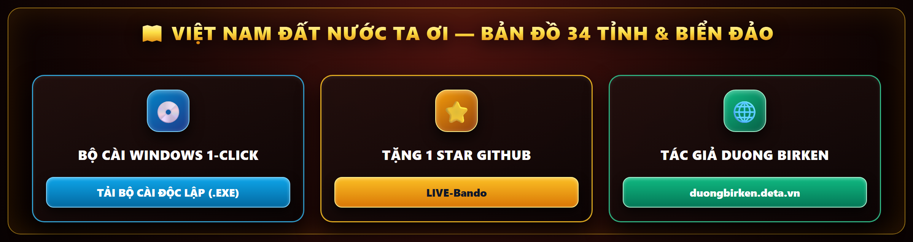
  </a>
    
  <h3>
    💿 <a href="https://github.com/duongbirken2510/LIVE-Bando/releases/latest/download/Viet-Nam-Dat-Nuoc-Ta-Oi-Setup-v1.0.exe"><b>[1. TẢI NGAY BỘ CÀI WINDOWS 1-CLICK (.EXE)]</b></a>
    &nbsp;·&nbsp;
    ⭐ <a href="https://github.com/duongbirken2510/LIVE-Bando"><b>[2. TẶNG 1 STAR TRÊN GITHUB]</b></a>
    &nbsp;·&nbsp;
    🌐 <a href="https://duongbirken.deta.vn"><b>[3. GHÉ THĂM DUONGBIRKEN.DETA.VN]</b></a>
  </h3>

---

## 👨‍💻 Tác Giả & Liên Hệ / Author & Contact

| 🇻🇳 Lời nhắn từ Tác giả | 🇬🇧 Note from the Author |
| :--- | :--- |
| **LIVE-BANDO (`Việt Nam Đất Nước Ta Ơi`)** là dự án tâm huyết được phát triển và hoàn thiện bởi **Duong Birken**. Nếu dự án hữu ích với bạn, hãy tặng một ngôi sao (**⭐ Star**) trên GitHub hoặc ghé thăm website chính thức để kết nối, khám phá thêm các công cụ livestream tương tác tự động và góp ý nhé! | **LIVE-BANDO (`Việt Nam Đất Nước Ta Ơi`)** is crafted with passion by **Duong Birken**. If you find this project helpful, please consider giving it a **⭐ Star** on GitHub or visiting the official website to connect and share your feedback! |

- **🌐 Website chính thức & Liên hệ tác giả:** [**https://duongbirken.deta.vn**](https://duongbirken.deta.vn)
- **🐙 GitHub Profile:** [**https://github.com/duongbirken2510**](https://github.com/duongbirken2510)
- **📦 Kho mã nguồn dự án:** [**https://github.com/duongbirken2510/LIVE-Bando**](https://github.com/duongbirken2510/LIVE-Bando)
- **💿 Hướng dẫn Tải Bộ Cài `.EXE` 1-Click:** [**`DOWNLOAD_APP.md`**](./DOWNLOAD_APP.md)
- **🗺️ Hồ sơ Giới thiệu Sản phẩm & Công nghệ 10 Chương (`info/`):** [**`info/Introduce_VietNamDatNuocTaOi.md`**](./info/Introduce_VietNamDatNuocTaOi.md)
- **📖 Cẩm nang Hướng dẫn Sử dụng A–Z (`docs/USER_GUIDE.md`):** [**`docs/USER_GUIDE.md`**](./docs/USER_GUIDE.md)
