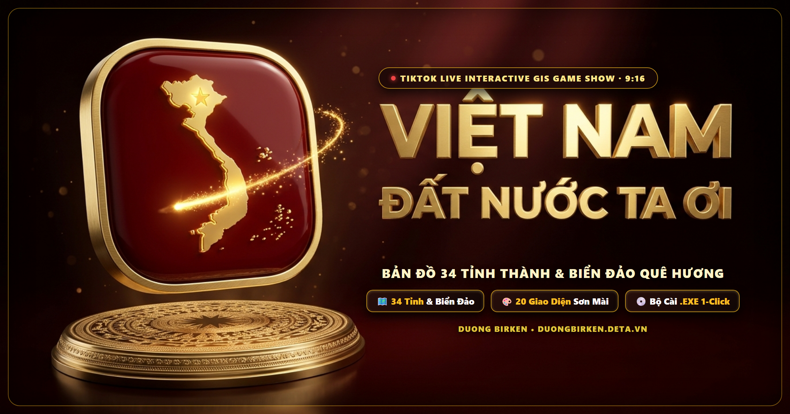
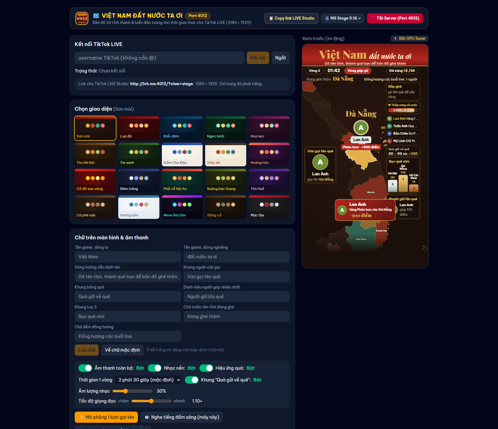
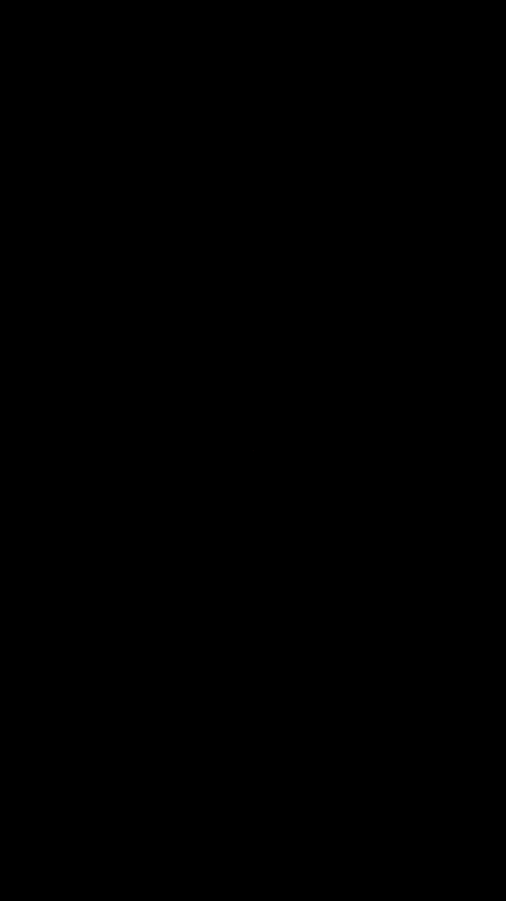
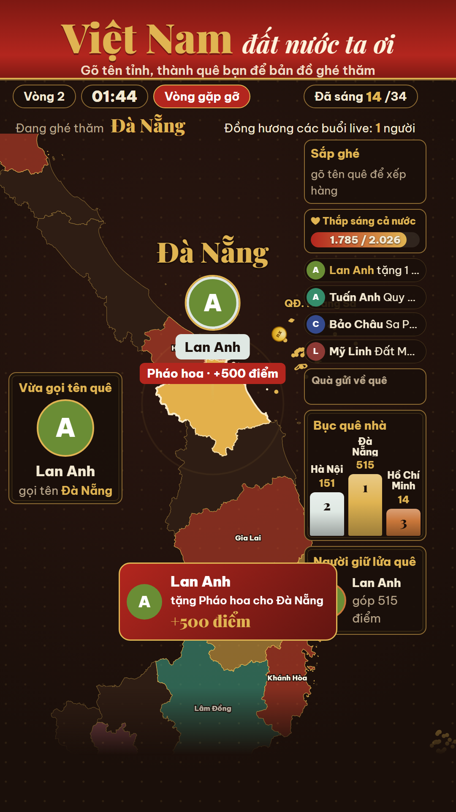
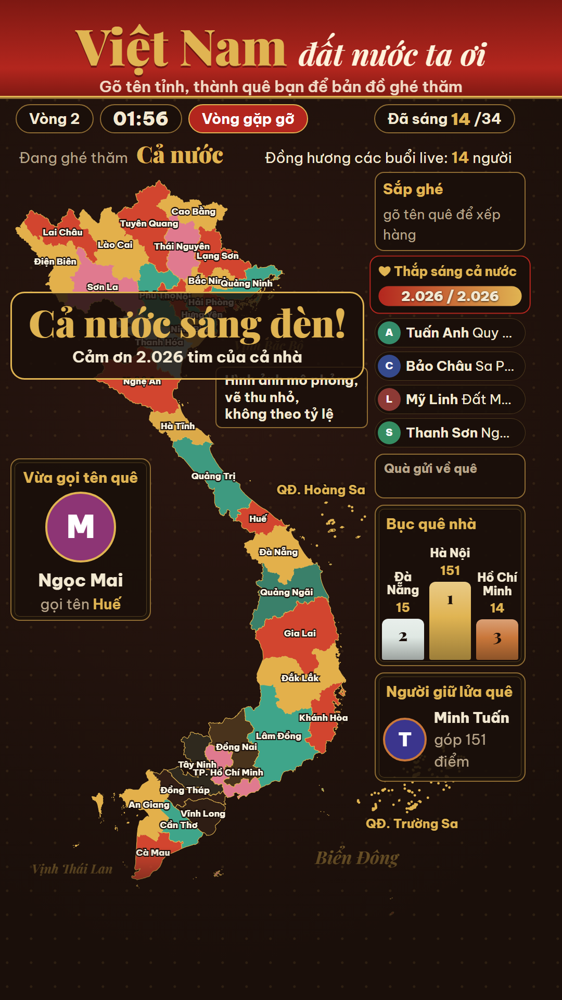
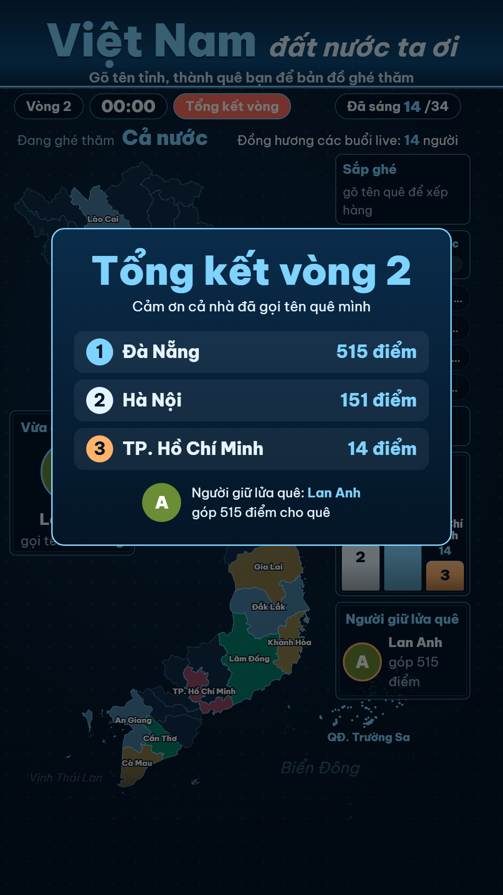
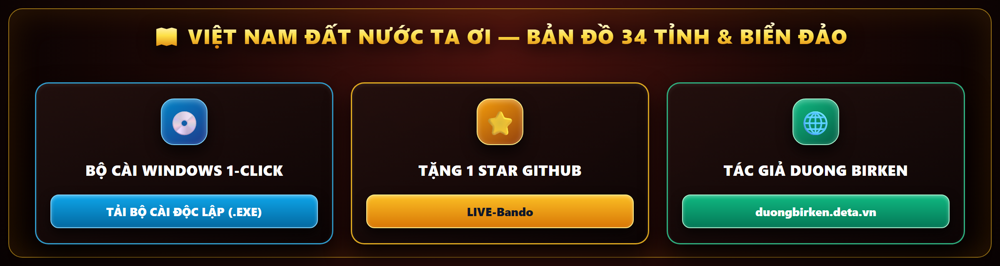

# 🗺️ Việt Nam Đất Nước Ta Ơi (`LIVE-BANDO`) v1.0.0 — Official Release (Port `4012` + System Tray Guardian v2)

  

---

## 💿 Tải Bộ Cài Đặt Windows 1-Click (`Viet-Nam-Dat-Nuoc-Ta-Oi-Setup-v1.0.exe`)

- 👉 **[Tải ngay `Viet-Nam-Dat-Nuoc-Ta-Oi-Setup-v1.0.exe` (1-Click Windows Setup)](https://github.com/duongbirken2510/LIVE-Bando/releases/download/v1.0.0/Viet-Nam-Dat-Nuoc-Ta-Oi-Setup-v1.0.exe)** *(Đã tích hợp sẵn toàn bộ Node.js Runtime + System Tray Guardian v2 + Bản đồ 34 Tỉnh Thành & Hoàng Sa - Trường Sa + 20 Giao Diện Sơn Mài + Giọng MC AI — Tải về nhấp đúp cài đặt là chạy ngay trên cổng `4012`, không cần cài Node.js!)*
- 👉 **[Tải Launcher rời `Viet-Nam-Dat-Nuoc-Ta-Oi.exe`](https://github.com/duongbirken2510/LIVE-Bando/releases/download/v1.0.0/Viet-Nam-Dat-Nuoc-Ta-Oi.exe)** *(File chạy trực tiếp từ thư mục mã nguồn ở chế độ Desktop App `--app` kèm biểu tượng Khay hệ thống góc đồng hồ Windows).*

---

## 🇻🇳 Điểm Mới Nổi Bật Trong Phiên Bản v1.0.0

1. **Bản Đồ Việt Nam 34 Tỉnh Thành Mới (2025) & Quần Đảo Hoàng Sa – Trường Sa (`1080 × 1920`):**
   - Cập nhật đầy đủ 34 tỉnh, thành phố theo Nghị quyết 202/2025/QH15, quần đảo **Hoàng Sa** (TP. Đà Nẵng), quần đảo **Trường Sa** (tỉnh Khánh Hòa) và hơn **125 đảo lớn nhỏ** (*Phú Quốc, Côn Đảo, Cát Bà, Lý Sơn, Cô Tô, Bạch Long Vĩ, Thổ Chu, Nam Du...*).
   - Nhận diện thông minh cả tên tỉnh mới, tên tỉnh cũ trước sáp nhập (*Kiên Giang, Hải Dương, Bình Dương, Bà Rịa - Vũng Tàu, Quảng Nam...*), tên thành phố trực thuộc (*Hạ Long, Nha Trang, Đà Lạt, Sa Pa, Hội An...*), chữ không dấu, viết tắt (*HN, SG, HCM, BMT*) và chữ viết liền (*thanhhoa, danang, halong*).
2. **Hiệu Ứng Camera Zoom Cận Cảnh & Đốm Sáng Bay Vòng Cung (`d3-interpolate`):**
   - Mỗi khi người xem gọi tên quê, đốm sáng bay vòng cung từ Avatar khung *"Vừa gọi tên quê"* vào đúng tâm tỉnh/đảo (`750ms`), chạm đích lóe sáng, thắp sáng tỉnh theo màu giao diện và ghim Avatar + tên người gọi + số điểm cộng.
3. **MC AI Kể Món Ngon, Danh Thắng & Lời Thương Gửi Chiến Sĩ Giữ Đảo Xa:**
   - Hỗ trợ 2 giọng MC AI tiếng Việt truyền cảm (**Nữ Hoài My** & **Nam Nam Minh**) tự động gọi tên người xem, nhắc 1–2 đặc sản, danh lam thắng cảnh và lời khen tính cách người quê đó (`src/game/provinceTalk.ts`).
   - Khi khán giả gõ tên các đảo thuộc Hoàng Sa, Trường Sa hoặc đảo tiền tiêu, camera phóng vào cụm đảo và MC gửi lời thương tới các anh chiến sĩ đang làm nhiệm vụ giữ đảo xa nhà.
4. **20 Giao Diện Văn Hóa Việt Nam & Sơn Mài Truyền Thống (`src/game/themes.ts`):**
   - Chuyển đổi tức thì 1 chạm giữa 20 bộ màu: *Sơn mài, Lụa đỏ, Biển đêm, Ngọc bích, Hoa sen, Thu Hà Nội, Tre xanh, Gốm Chu Đậu, Giấy dó, Hoàng hôn, Cờ đỏ sao vàng, Đêm trăng, Phố cổ Hội An, Ruộng bậc thang, Tím Huế, Cà phê sữa, Sương sớm, Neon Sài Gòn, Đồng cổ, Mực tàu*.
5. **Thanh Tim Chung `2.026 Tim — Cả Nước Sáng Đèn!` & 5 Tầng Hiệu Ứng Quà Tặng:**
   - Cả phòng chung tay thả đủ **2.026 tim**, toàn bộ 34 tỉnh thành cùng thắp sáng lan từ Bắc vào Nam trong 5 giây kèm nhạc mừng ngũ cung.
   - 5 tầng hiệu ứng quà tặng (*Đốm sáng ➔ Mưa xu ➔ Băng rôn ➔ Pháo hoa trên tỉnh ➔ Đại tiệc pháo hoa toàn màn hình & kèn chào*), hỗ trợ giữ xu cộng bù (`pendingXu`) cho người tặng quà trước khi gõ tên quê.
6. **System Tray Guardian v2, Cổng Mặc Định `4012` & Chế Độ Tiết Kiệm GPU (`GPU Saver`):**
   - Chạy trên cổng mặc định **`4012`** (`http://localhost:4012` & `http://lvh.me:4012/?view=stage`) để không bao giờ xung đột cổng với các công cụ livestream khác.
   - Tích hợp **System Tray Guardian v2** ở góc đồng hồ Windows (hiện thông báo Balloon tức thì khi đóng cửa sổ điều khiển, click chuột trái/phải mở menu nhanh hoặc **`🔌 Thoát Hẳn & Tắt Server (Port 4012)`**), cùng chế độ **GPU Saver** tự động nhường 100% hiệu năng đồ họa cho TikTok LIVE Studio.

---

## 🖼️ Giao Diện Thực Tế (`Admin Dashboard & Sân Khấu 1080 × 1920`)

  

| 🗺️ **Sân Khấu Sơn Mài Toàn Cảnh** | 📍 **Camera Zoom Cận Cảnh & Ghim Quê** | ❤️ **2.026 Tim — Cả Nước Sáng Đèn!** | 🌙 **Giao Diện Biển Đêm & Tổng Kết Vòng** |
| :---: | :---: | :---: | :---: |
|  |  |  |  |

---

## 👨‍💻 Tác Giả & Liên Hệ / Author & Contact

  

| 🇻🇳 Lời nhắn từ Tác giả | 🇬🇧 Note from the Author |
| :--- | :--- |
| **LIVE-BANDO (`Việt Nam Đất Nước Ta Ơi`)** là dự án tâm huyết được phát triển bởi **Duong Birken**. Nếu dự án hữu ích với bạn, hãy tặng một ngôi sao (**⭐ Star**) trên GitHub hoặc ghé thăm website chính thức để kết nối và góp ý nhé! | **LIVE-BANDO (`Việt Nam Đất Nước Ta Ơi`)** is crafted with passion by **Duong Birken**. If you find this project helpful, please consider giving it a **⭐ Star** on GitHub or visiting the official website to connect and share your feedback! |

- **🌐 Website chính thức & Liên hệ tác giả:** [**https://duongbirken.deta.vn**](https://duongbirken.deta.vn)
- **🐙 GitHub Profile:** [**https://github.com/duongbirken2510**](https://github.com/duongbirken2510)
- **📖 Cẩm nang Hướng dẫn Sử dụng A–Z:** [**docs/USER_GUIDE.md**](https://github.com/duongbirken2510/LIVE-Bando/blob/master/docs/USER_GUIDE.md)
- **🗺️ Hồ sơ Giới thiệu Sản phẩm & Công nghệ 10 Chương:** [**info/Introduce_VietNamDatNuocTaOi.md**](https://github.com/duongbirken2510/LIVE-Bando/blob/master/info/Introduce_VietNamDatNuocTaOi.md)
