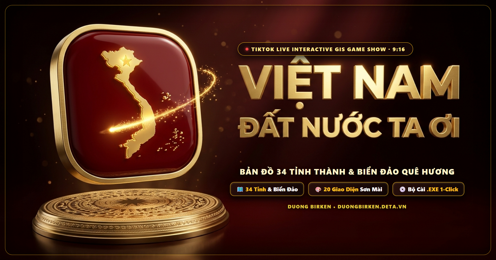
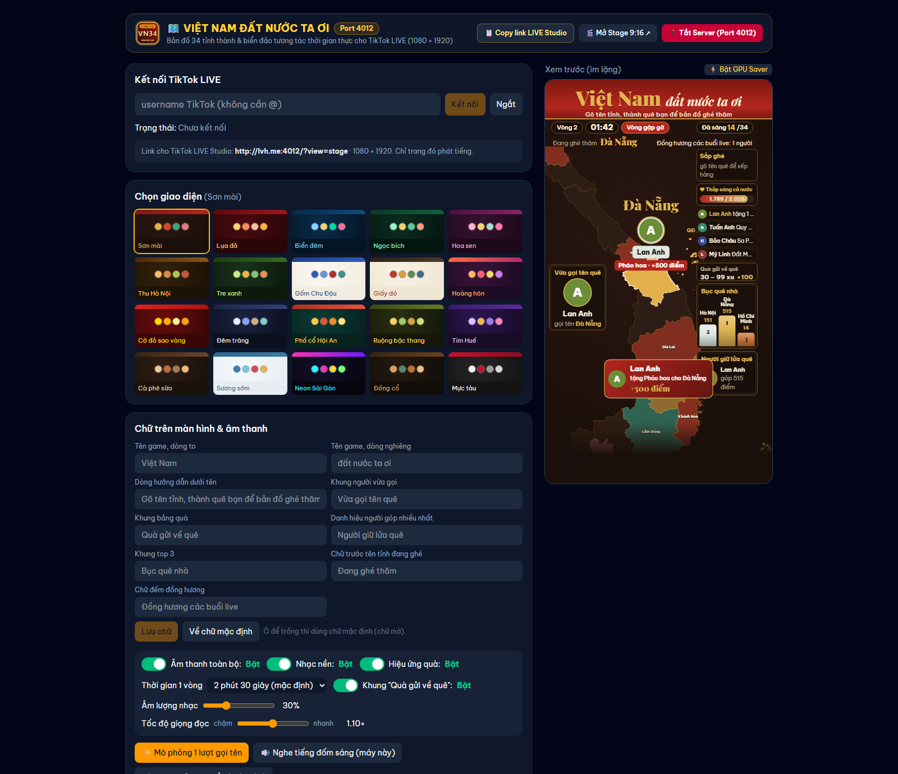
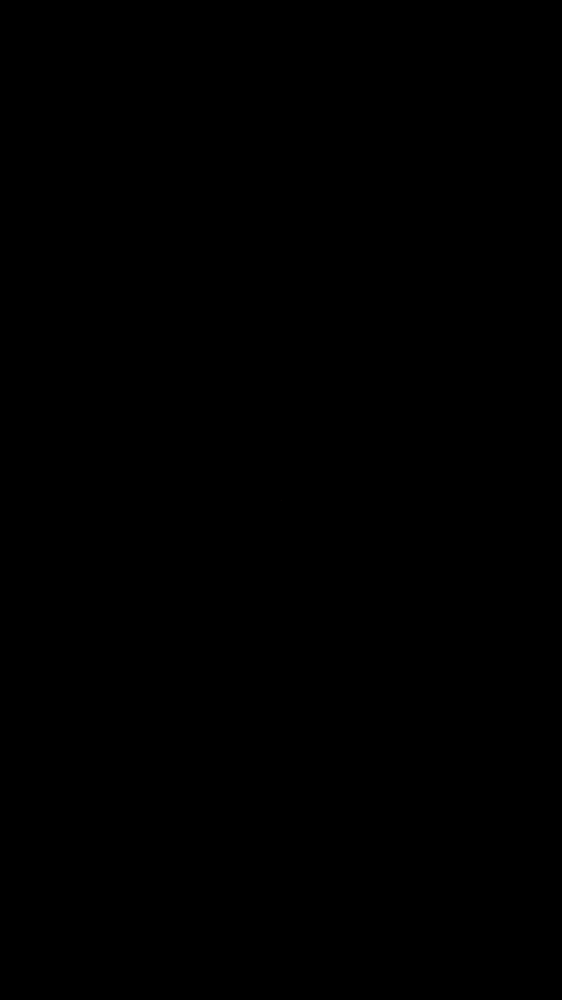
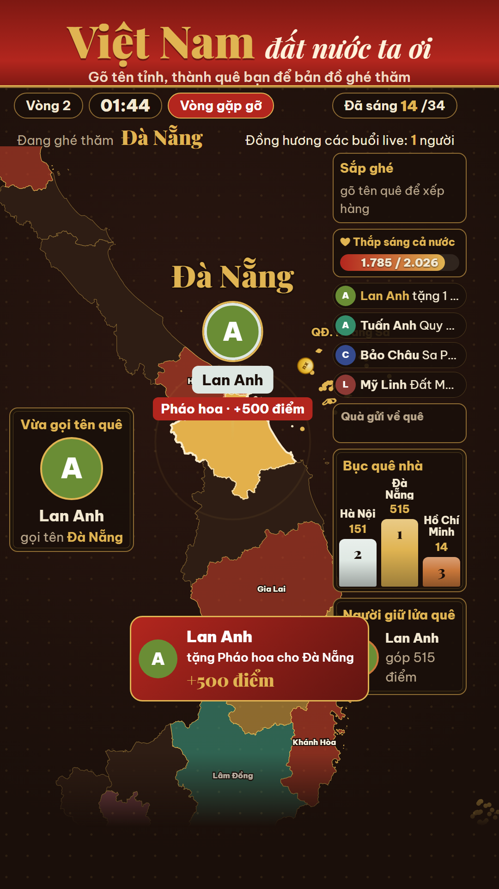
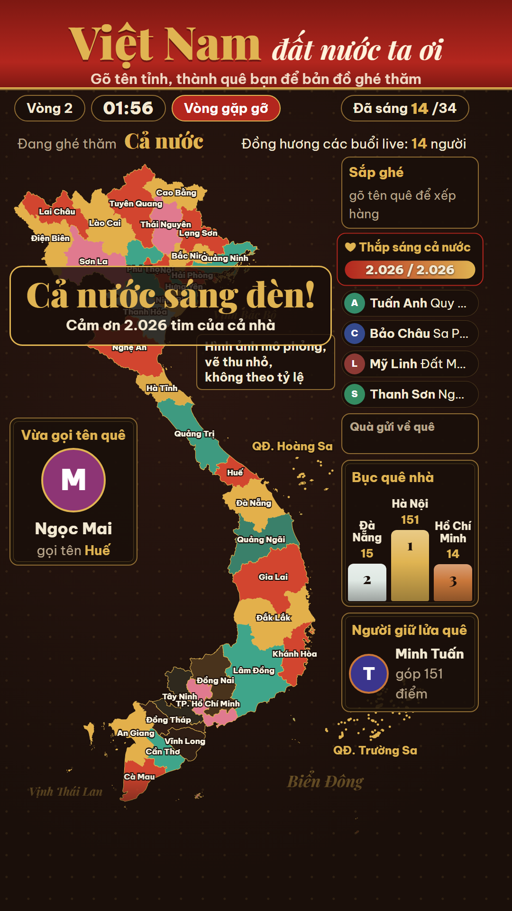
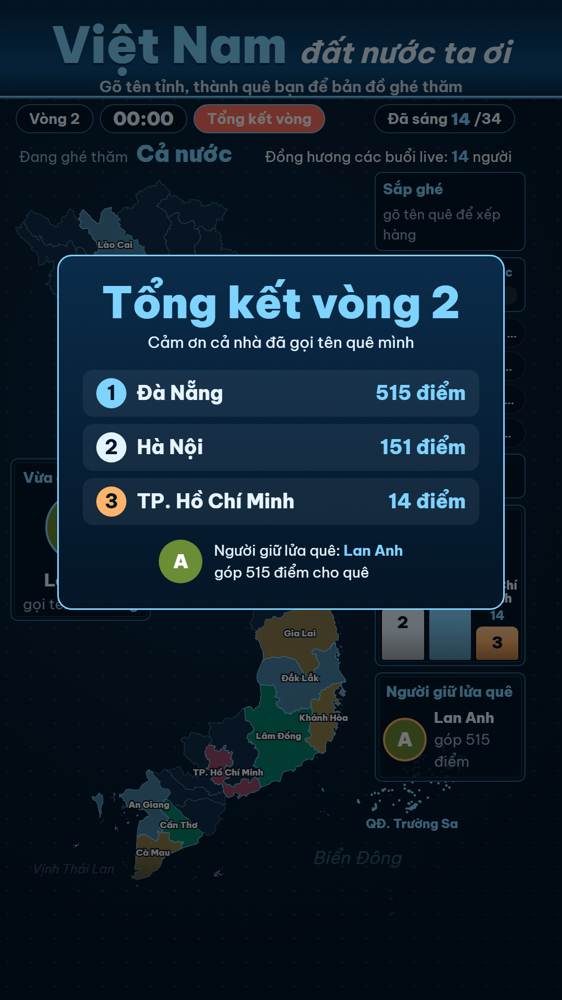
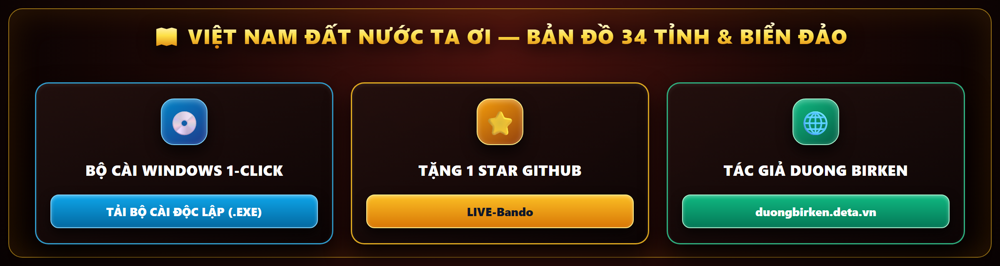

# 📖 CẨM NANG HƯỚNG DẪN SỬ DỤNG VIỆT NAM ĐẤT NƯỚC TA ƠI TOÀN TẬP (A–Z)
## Việt Nam Đất Nước Ta Ơi (`LIVE-BANDO`) v1.0.0 — Bilingual User Guide (Tiếng Việt & English)

<div align="center">
  
  <br /><br />
  <h3>
    💿 👉 <a href="https://github.com/duongbirken2510/LIVE-Bando/releases/latest/download/Viet-Nam-Dat-Nuoc-Ta-Oi-Setup-v1.0.exe"><b>[TẢI NGAY BỘ CÀI ĐẶT WINDOWS 1-CLICK: Viet-Nam-Dat-Nuoc-Ta-Oi-Setup-v1.0.exe]</b></a> 👈
  </h3>
  <p><i>(Đã nhúng sẵn Node.js Runtime + System Tray Guardian v2 + Bản đồ 34 Tỉnh Thành &amp; Hoàng Sa - Trường Sa + 20 Giao Diện Sơn Mài + Giọng MC AI — Tải về nhấp đúp là tự tạo icon Desktop và chạy ngay trên cổng 4012, KHÔNG cần cài đặt Node.js!)</i></p>
</div>

> **Tác giả / Author:** **Duong Birken** — [https://duongbirken.deta.vn](https://duongbirken.deta.vn)  
> **Kho mã nguồn chính thức / Official GitHub Repository:** [https://github.com/duongbirken2510/LIVE-Bando](https://github.com/duongbirken2510/LIVE-Bando)  
> **Tải bộ cài đặt `.EXE` 1-Click / 1-Click Installer:** [GitHub Releases v1.0.0](https://github.com/duongbirken2510/LIVE-Bando/releases/latest) · [`../DOWNLOAD_APP.md`](../DOWNLOAD_APP.md)  
> **Hồ sơ Giới thiệu Sản phẩm & Công nghệ (10 Chương):** [`../info/Introduce_VietNamDatNuocTaOi.md`](../info/Introduce_VietNamDatNuocTaOi.md)  
> **Cổng vận hành mặc định / Default Ports:** Admin `http://localhost:4012` · TikTok LIVE Studio Stage `http://lvh.me:4012/?view=stage` (`1080 × 1920`)

---

## ⚠️ Đọc Trước Khi Dùng: Lưu Ý, Cảnh Báo & Trách Nhiệm Pháp Lý

Trò chơi được chia sẻ miễn phí cho cộng đồng nhà sáng tạo nội dung. Trước khi sử dụng cho buổi phát trực tiếp của bạn, vui lòng đọc kỹ 7 nguyên tắc bắt buộc sau:

1. **Bản đồ là hình mô phỏng:** Quần đảo **Hoàng Sa** và **Trường Sa** được vẽ thu nhỏ, đặt gần bờ hơn thực tế để vừa khung hình dọc `9:16`. Ranh giới 34 tỉnh, thành phố lấy từ bộ dữ liệu cộng đồng, không phải bản đồ hành chính chính thức của cơ quan nhà nước. Trên màn hình đã có dòng ghi chú **"Hình ảnh mô phỏng, vẽ thu nhỏ, không theo tỷ lệ"** — tuyệt đối không xóa dòng này và phải luôn giữ đủ Hoàng Sa, Trường Sa.
2. **Không dùng game để trao thưởng:** Game chỉ cộng điểm vui cho quê hương trong từng vòng, hoàn toàn không có giải thưởng tiền hay hiện vật. Nếu bạn tự đặt thêm thưởng tiền/quà cho người đứng top, việc đó có thể bị xem là khuyến mại hoặc trò chơi có thưởng theo quy định pháp luật và bạn tự chịu trách nhiệm làm thủ tục.
3. **Tiền quà tặng là thu nhập của chủ kênh:** Quà người xem tặng trên TikTok LIVE là thu nhập của người phát trực tiếp; bạn tự tìm hiểu và thực hiện nghĩa vụ kê khai, nộp thuế theo quy định hiện hành.
4. **Kết nối và giọng đọc dùng thư viện bên thứ ba:** Game kết nối phòng live và tạo giọng MC qua công cụ mã nguồn mở không chính thức nên có thể gián đoạn bất cứ lúc nào; rủi ro đối với tài khoản phát sóng bạn tự cân nhắc.
5. **Chủ kênh luôn phải giám sát nội dung phòng live:** Dù game đã có bộ lọc từ tục 3 lớp và MC không bao giờ đọc nguyên văn bình luận tự do, chủ kênh vẫn phải để mắt và chịu trách nhiệm về nội dung buổi live của mình.
6. **Lời MC kể đặc sản & danh thắng các tỉnh:** Được biên soạn theo hiểu biết văn hóa phổ thông trong `src/game/provinceTalk.ts`; nếu thấy chi tiết nào cần chỉnh sửa cho sát thực tế địa phương, bạn có thể sửa trực tiếp tại file này.
7. **Miễn trừ trách nhiệm:** Phần mềm được cung cấp nguyên trạng (*"as-is"*), tác giả không chịu trách nhiệm về bất kỳ thiệt hại hay rắc rối pháp lý nào phát sinh trong quá trình bạn vận hành.

---

## 📑 Mục Lục Nhanh / Quick Navigation
- **Phần A — 🇻🇳 Hướng Dẫn Sử Dụng Tiếng Việt (Từ A đến Z)**
  1. [Bước 1: Cài đặt & Khởi chạy nhanh 1-Click trên Windows, macOS và Linux](#1-bước-1-cài-đặt--khởi-chạy-nhanh-1-click-trên-windows-macos-và-linux)
  2. [Bước 2: Đưa màn hình sân khấu 1080×1920 vào TikTok LIVE Studio & Kết nối phòng Live](#2-bước-2-đưa-màn-hình-sân-khấu-10801920-vào-tiktok-live-studio--kết-nối-phòng-live)
  3. [Bước 3: Tùy chỉnh 20 giao diện sơn mài, Chữ trên màn hình & Giọng MC AI](#3-bước-3-tùy-chỉnh-20-giao-diện-sơn-mài-chữ-trên-màn-hình--giọng-mc-ai)
  4. [Bước 4: Luật chơi chi tiết, Thanh 2.026 tim thắp sáng cả nước & 5 tầng quà tặng](#4-bước-4-luật-chơi-chi-tiết-thanh-2026-tim-thắp-sáng-cả-nước--5-tầng-quà-tặng)
  5. [Bước 5: Thử nghiệm trước khi Live với Bộ giả lập & Live tự động 10/50/100 người](#5-bước-5-thử-nghiệm-trước-khi-live-với-bộ-giả-lập--live-tự-động-1050100-người)
  6. [Bước 6: Quản lý dữ liệu cài đặt, Mẹo giữ chân người xem & Xử lý sự cố thường gặp](#6-bước-6-quản-lý-dữ-liệu-cài-đặt-mẹo-giữ-chân-người-xem--xử-lý-sự-cố-thường-gặp)
- **Part B — 🇬🇧 English User Guide (Step-by-Step)**
  1. [Step 1: 1-Click Windows `.EXE` Setup & Cross-Platform Launch](#step-1-1-click-windows-exe-setup--cross-platform-launch)
  2. [Step 2: Adding the 1080×1920 Stage to TikTok LIVE Studio / OBS](#step-2-adding-the-10801920-stage-to-tiktok-live-studio--obs)
  3. [Step 3: Customizing 20 Cultural Themes, Labels, Audio & AI MC Voice](#step-3-customizing-20-cultural-themes-labels-audio--ai-mc-voice)
  4. [Step 4: Gameplay Rules, Simulation & Troubleshooting](#step-4-gameplay-rules-simulation--troubleshooting)

---

# 🇻🇳 PHẦN A — HƯỚNG DẪN SỬ DỤNG TIẾNG VIỆT (TỪ A ĐẾN Z)

## 1. Bước 1: Cài đặt & Khởi chạy nhanh 1-Click trên Windows, macOS và Linux

### 💿 Cách A — Dùng Bộ Cài Đặt `.EXE` 1-Click (Khuyên dùng cho người không rành GitHub / Node.js)
1. Tải file cài đặt duy nhất: **[`Viet-Nam-Dat-Nuoc-Ta-Oi-Setup-v1.0.exe`](https://github.com/duongbirken2510/LIVE-Bando/releases/latest/download/Viet-Nam-Dat-Nuoc-Ta-Oi-Setup-v1.0.exe)** từ trang **[GitHub Releases](https://github.com/duongbirken2510/LIVE-Bando/releases/latest)**.
2. Nhấp đúp mở `Viet-Nam-Dat-Nuoc-Ta-Oi-Setup-v1.0.exe`:
   - Nếu Windows hiện bảng xanh *Windows protected your PC (SmartScreen)*: bấm vào chữ **More info** (*Thông tin thêm*) ➔ bấm **Run anyway** (*Vẫn chạy*).
3. Bấm nút **`🚀 CÀI ĐẶT NGAY (1-CLICK)`**:
   - Bộ cài đặt đã tích hợp sẵn Node.js Runtime và toàn bộ dữ liệu bản đồ 34 tỉnh thành, sẽ tự động giải nén, **tạo biểu tượng `Việt Nam Đất Nước Ta Ơi - TikTok LIVE` ngoài màn hình Desktop**, hiển thị biểu tượng **System Tray Guardian** ở góc đồng hồ Windows và mở ngay trang điều khiển ở chế độ Desktop App tại `http://localhost:4012`!
4. Những lần sử dụng sau, bạn chỉ cần nhấp đúp vào biểu tượng **`Việt Nam Đất Nước Ta Ơi - TikTok LIVE`** ngoài Desktop (hoặc chạy `Viet-Nam-Dat-Nuoc-Ta-Oi.exe`).
5. **Cách thu gọn xuống Khay hệ thống & Thoát hẳn:**
   - Khi bạn bấm dấu `X` đóng cửa sổ điều khiển, phần mềm tự động thu gọn xuống **Khay Hệ Thống (góc đồng hồ Windows)** và hiện thông báo Balloon nhắc bạn rằng sân khấu TikTok LIVE vẫn đang chạy bình thường.
   - Muốn mở lại hoặc tắt hẳn: Click chuột trái hoặc phải vào biểu tượng **`VN34`** ở góc đồng hồ Windows ➔ chọn **`🗺️ Mở Bàn Điều Khiển (Port 4012)`** hoặc chọn dòng chữ đỏ **`🔌 Thoát Hẳn & Tắt Server (Port 4012)`** (hoặc bấm nút đỏ **`🔌 Tắt Server (Port 4012)`** ngay góc trên bên phải trang điều khiển).

### 💻 Cách B — Chạy từ thư mục mã nguồn bằng `BAT-LIVE.bat` trên Windows 10 / 11
1. Nếu chưa cài **Node.js**, truy cập [https://nodejs.org](https://nodejs.org), tải bản **LTS** và bấm *Next ➔ Install* (cài 1 lần duy nhất).
2. Tải mã nguồn dự án về máy và **giải nén hoàn toàn** ra thư mục (ví dụ: `D:\Game\LIVE-BANDO`).
3. Nhấp đúp vào file **[`BAT-LIVE.bat`](../BAT-LIVE.bat)**:
   - Lần đầu tiên chạy, game tự động cài đặt thư viện (`npm install`) trong khoảng 1–2 phút.
   - Sau đó hệ thống tự động chạy ngầm Server trên cổng `4012` và mở **Trang điều khiển Admin** ở chế độ cửa sổ ứng dụng (`http://localhost:4012`).
   - Khi muốn tắt hẳn server để giải phóng cổng `4012`, bấm nút đỏ **`🔌 Tắt Server (Port 4012)`** trên trang điều khiển hoặc nhấp đúp vào file **[`TAT-LIVE.bat`](../TAT-LIVE.bat)**.

### 🍎🐧 Cách C — Chạy trên macOS / Linux qua Terminal
```bash
# Cài đặt thư viện (chỉ cần chạy lần đầu)
npm install

# Khởi chạy ở chế độ LIVE_MODE trên cổng 4012 (tắt tự động tải lại HMR để sân khấu luôn ổn định)
LIVE_MODE=1 npm run dev
```

---

## 2. Bước 2: Đưa màn hình sân khấu 1080×1920 vào TikTok LIVE Studio & Kết nối phòng Live



### 🎬 A. Đưa màn hình Sân khấu vào TikTok LIVE Studio (hoặc OBS Studio)
1. Trên thanh đầu trang điều khiển (`http://localhost:4012`), bấm nút **`📋 Copy link LIVE Studio`** để sao chép nhanh đường dẫn sân khấu.
2. Mở phần mềm **TikTok LIVE Studio** (chọn bố cục màn hình dọc `9:16`).
3. Bấm **Thêm nguồn (Add Source)** ➔ chọn **Liên kết (Link / Browser Source)**.
4. Dán đường dẫn:
   ```text
   http://lvh.me:4012/?view=stage
   ```
   *(Lưu ý: Nếu cổng `4012` trên máy đang bận bởi ứng dụng khác, server sẽ tự động chuyển sang cổng `4013`, `4014`... — bạn chỉ cần bấm nút `📋 Copy link LIVE Studio` trên trang điều khiển để luôn lấy đúng cổng đang chạy).*
5. Đặt kích thước nguồn hình: Chiều rộng **`1080`** × Chiều cao **`1920`**.
6. **Chế độ Tiết kiệm GPU tự động (`⚡ GPU Saver`):** Ngay khi bạn gắn link vào TikTok LIVE Studio, trang điều khiển Admin sẽ tự động tạm ẩn khung xem trước phụ để dành 100% hiệu năng đồ họa cho buổi Live (bạn vẫn có thể bấm nút **`👁️ Vẫn bật xem Sân khấu trực tiếp tại đây`** nếu muốn nhìn trực tiếp trên trang Admin).

### 🔗 B. Kết nối với phòng TikTok LIVE đang phát sóng
1. Bấm nút **Phát trực tiếp (Go LIVE)** trên TikTok LIVE Studio trước.
2. Tại **Trang điều khiển** (`http://localhost:4012`), trong khung **Kết nối TikTok LIVE** ở trên cùng:
   - Nhập `username` TikTok của kênh đang live (không cần gõ dấu `@`).
   - Bấm nút màu vàng **Kết nối**.
3. Khi dòng trạng thái hiện chữ xanh **`Đang live @username · X người xem · Y tim`**, mọi bình luận gọi tên tỉnh/thành/đảo, lượt thả tim và quà tặng của khán giả sẽ tự động bay thẳng vào bản đồ!

---

## 3. Bước 3: Tùy chỉnh 20 giao diện sơn mài, Chữ trên màn hình & Giọng MC AI

Mọi tùy chỉnh dưới đây đều thực hiện trực tiếp bằng chuột trên Trang điều khiển và được tự động lưu vào `settings.json` (lần sau mở lại vẫn giữ nguyên):

### 🎨 A. Chọn 20 Giao diện Bản đồ Văn hóa Việt Nam
Ngay dưới khung Kết nối là bảng **Chọn giao diện** với 20 phong cách mỹ thuật:
- **Truyền thống & Sơn mài:** *Sơn mài (mặc định), Lụa đỏ, Đồng cổ, Mực tàu, Cờ đỏ sao vàng*.
- **Di sản & Vùng miền:** *Gốm Chu Đậu, Giấy dó, Thu Hà Nội, Phố cổ Hội An, Tím Huế, Ruộng bậc thang*.
- **Thiên nhiên & Hiện đại:** *Biển đêm, Ngọc bích, Hoa sen, Tre xanh, Hoàng hôn, Đêm trăng, Cà phê sữa, Sương sớm, Neon Sài Gòn*.
- Chỉ cần bấm vào ô màu bất kỳ, cả khung xem trước và màn hình trong TikTok LIVE Studio sẽ chuyển màu tức thì!

### ✍️ B. Sửa Chữ trên màn hình, Thời gian vòng & Âm thanh
Trong khung **Chữ trên màn hình & âm thanh**, bạn có thể:
1. **Đổi 9 nhãn chữ hiển thị trên sân khấu:** Tên game dòng 1 (*Việt Nam*), Tên game dòng 2 (*đất nước ta ơi*), Dòng hướng dẫn, Khung *Vừa gọi tên quê*, *Quà gửi về quê*, *Người giữ lửa quê*, *Bục quê nhà*, *Đang ghé thăm*, *Đồng hương các buổi live* ➔ Bấm **Lưu chữ** (hoặc **Về chữ mặc định**).
2. **Bật/Tắt các công tắc:**
   - **Âm thanh toàn bộ:** Tắt nhanh toàn bộ tiếng nhạc, hiệu ứng và giọng đọc.
   - **Nhạc nền:** Bật/tắt bản nhạc ngũ cung 116 BPM tự tổng hợp (0% bản quyền) và kéo thanh **Âm lượng nhạc (`0% – 100%`)**.
   - **Hiệu ứng quà:** Bật/tắt mưa xu, băng rôn và pháo hoa khi có người tặng quà.
   - **Thời gian 1 vòng:** Chọn thời lượng mỗi vòng từ **`1 phút` đến `10 phút`** (mặc định `2 phút 30 giây`).
   - **Tốc độ giọng đọc:** Kéo thanh trượt từ `0.70×` (chậm) đến `1.50×` (nhanh, mặc định `1.10×`).

### 🎙️ C. Đổi Giọng MC AI (Nữ Hoài My / Nam Nam Minh) & Đọc Câu Tùy Ý
Trong khung **Giọng đọc trên stage**:
- Chọn **👩 Nữ (Hoài My)** hoặc **👨 Nam (Nam Minh)** và bấm **🔊 Nghe thử**.
- Đổi **Tên kênh** để MC tự xưng khi chào người mới vào phòng và khi cảm ơn lượt Follow / Chia sẻ.
- Gõ bất kỳ câu nào vào ô *"Gõ câu muốn đọc ngay..."* và nhấn `Enter` (hoặc bấm **Đọc ngay**) để MC phát biểu trực tiếp trên sóng live!

---

## 4. Bước 4: Luật chơi chi tiết, Thanh 2.026 tim thắp sáng cả nước & 5 tầng quà tặng

| 🗺️ **Sân Khấu Sơn Mài Toàn Cảnh** | 📍 **Camera Zoom & Đốm Sáng Bay Vào Tỉnh** | ❤️ **2.026 Tim — Cả Nước Sáng Đèn!** | 🌙 **Giao Diện Biển Đêm & Tổng Kết Vòng** |
| :---: | :---: | :---: | :---: |
|  |  |  |  |

1. **Cách gọi tên quê (`+1 điểm`):**
   - Khán giả gõ tên tỉnh/thành phố mới (34 tỉnh từ 2025), tên tỉnh cũ trước sáp nhập (*Kiên Giang, Hải Dương, Bình Dương, Quảng Nam...*), tên thành phố (*Hạ Long, Nha Trang, Đà Lạt, Sa Pa...*) hoặc tên đảo (*Phú Quốc, Côn Đảo, Lý Sơn, Hoàng Sa, Trường Sa...*) — có dấu, không dấu, viết tắt (`HN`, `SG`, `HCM`) hay gõ dính liền (`thanhhoa`, `danang`) đều được nhận diện chuẩn xác!
   - Mỗi lượt bình luận cộng **`+1 điểm`** cho quê (thời gian hồi `10 giây`/người/tỉnh để chống spam). Tỉnh gõ gần nhất được ghi nhận là **quê của người chơi đó** trong vòng.
2. **Thả tim cá nhân & Thanh tim chung `2.026 Tim — Thắp sáng cả nước`:**
   - **Điểm cho quê:** Cứ mỗi **`15 tim`** khán giả thả sẽ cộng thêm **`+1 điểm`** cho tỉnh quê hương của người đó.
   - **Thắp sáng cả nước:** Mọi lượt tim của cả phòng đều cộng vào thanh **`❤ Thắp sáng cả nước`**. Ngay khi chạm mốc **`2.026 / 2.026 tim`**, toàn bộ 34 tỉnh thành cùng bừng sáng rực rỡ lan từ Bắc vào Nam trong 5 giây kèm nhạc mừng ngũ cung!
3. **5 Tầng Hiệu ứng Quà tặng & Cơ chế Cộng bù khi chưa chọn quê:**
   - `1 – 4 xu`: **`+3 điểm`** (Đốm sáng lấp lánh).
   - `5 – 29 xu`: **`+30 điểm`** (Mưa xu vàng + tiếng xu leng keng).
   - `30 – 99 xu`: **`+100 điểm`** (Mưa xu dày + Băng rôn vinh danh + **Ưu tiên chen lên đầu hàng chờ ghé thăm**).
   - `100 – 999 xu`: **`+500 điểm`** (Pháo hoa rực rỡ ngay trên tỉnh quê hương + kèn chào).
   - `Từ 1.000 xu trở lên`: **`+3.000 điểm`** (Đại tiệc pháo hoa toàn màn hình + Băng rôn Hoàng Kim + Kèn Fanfare đứng lâu 8 giây).
   - **Đặc biệt:** Nếu khán giả tặng quà khi chưa kịp bình luận tên quê, MC sẽ cảm ơn và nhắc khán giả gõ tên quê; số xu đó được **giữ nguyên qua các vòng** và cộng bù điểm ngay khoảnh khắc khán giả gõ tên quê!

---

## 5. Bước 5: Thử nghiệm trước khi Live với Bộ giả lập & Live tự động 10/50/100 người

Ngay cả khi chưa mở TikTok LIVE, bạn có thể kiểm tra toàn bộ hiệu ứng hình ảnh và âm thanh thông qua 3 bộ công cụ thử nghiệm trên Trang điều khiển:
1. **Trong khung Chữ trên màn hình & âm thanh:**
   - Bấm **✨ Mô phỏng 1 lượt gọi tên**, **🔊 Nghe tiếng đốm sáng**, **🎵 Nghe thử nhạc nền**, **5 nút Thử hiệu ứng quà (`3 xu` ➔ `1.000 xu`)** hoặc nút **❤ Thử đủ 2.026 tim (thắp sáng cả nước)**.
2. **Trong khung Thử game Việt Nam đất nước ta ơi (cuối trang):**
   - Thử các tình huống đặc biệt: **📍 1 người gọi tên tỉnh**, **🗺️ Gõ tên tỉnh cũ (Kiên Giang)**, **🏝️ Gõ Hoàng Sa**, **👥 60 người gọi liền**, **🎁 Gọi Đắk Lắk rồi tặng 199 xu**, **🍦 Tặng quà khi chưa chọn quê**, **⏭️ Qua giai đoạn kế** (để xem nhanh màn hình Tổng kết vòng).
3. **Trong khung Giả lập — Mục Live tự động:**
   - Bấm **`▶ 10 người`**, **`▶ 50 người`** hoặc **`▶ 100 người`** để hệ thống tự động nhảy về đầu vòng và mô phỏng một buổi live sôi động trọn vòng `2:45` với đầy đủ người vào, bình luận tên tỉnh, thả tim, tặng quà và follow!
   - *(Mẹo: Nếu muốn nghe tiếng khi thử trên trình duyệt mà chưa mở LIVE Studio, hãy mở tab `http://localhost:4012/?view=stage` và nhấp chuột 1 lần vào trang để trình duyệt mở khóa âm thanh; thử xong nhớ đóng tab đó trước khi live thật).*

---

## 6. Bước 6: Quản lý dữ liệu cài đặt, Mẹo giữ chân người xem & Xử lý sự cố thường gặp

### 💾 A. Quản lý dữ liệu cài đặt
- **`settings.json`** (nằm ngay tại thư mục gốc dự án): Lưu tên kênh, giọng đọc Nam/Nữ, giao diện màu đã chọn và toàn bộ cài đặt chữ trên màn hình, thời gian vòng, âm lượng.
- **Số đồng hương tích lũy (`Đồng hương các buổi live`):** Lưu trong `localStorage` của trình duyệt (`vndnto:fans`). Bạn có thể xóa về 0 bất cứ lúc nào bằng nút màu đỏ **Xoá số đồng hương** ở khung *Thử game*.

### 🛠️ B. Xử lý sự cố thường gặp
- **Nghe 2 giọng MC hoặc 2 lớp nhạc nền:** Do bạn đang mở trang `?view=stage` ở 2 nơi. Hệ thống đã có cảnh báo màu đỏ trên trang điều khiển khi phát hiện `> 1` trang stage và tự động chỉ phát tiếng ở trang mở sau cùng; bạn chỉ cần đóng tab `?view=stage` thừa trên trình duyệt và giữ lại duy nhất nguồn Link trong TikTok LIVE Studio.
- **MC không phát ra tiếng:** Kiểm tra kết nối mạng Internet, kiểm tra công tắc **Âm thanh toàn bộ** đã bật chưa, và đảm bảo đường dẫn trong TikTok LIVE Studio khớp đúng số cổng in trong khung *Kết nối TikTok LIVE*.
- **Bấm Kết nối báo tài khoản CHƯA LIVE:** Bạn phải bấm **Phát trực tiếp (Go LIVE)** trong TikTok LIVE Studio trước rồi mới bấm nút **Kết nối** trên trang điều khiển.

---

# 🇬🇧 PART B — ENGLISH USER GUIDE (STEP-BY-STEP)

## Step 1: 1-Click Windows `.EXE` Setup & Cross-Platform Launch
- **Option A — 1-Click Windows Standalone Installer (Recommended, No Node.js Required):**
  1. Download **[`Viet-Nam-Dat-Nuoc-Ta-Oi-Setup-v1.0.exe`](https://github.com/duongbirken2510/LIVE-Bando/releases/latest/download/Viet-Nam-Dat-Nuoc-Ta-Oi-Setup-v1.0.exe)** from **[GitHub Releases](https://github.com/duongbirken2510/LIVE-Bando/releases/latest)**.
  2. Double-click the installer (if Windows SmartScreen appears, click **More info** ➔ **Run anyway**) and click **`🚀 CÀI ĐẶT NGAY (1-CLICK)`**.
  3. The installer automatically extracts the bundled Node.js runtime and 34-province GIS map, creates the **`Việt Nam Đất Nước Ta Ơi - TikTok LIVE`** shortcut on your Desktop, starts **System Tray Guardian v2** near the Windows clock, and opens the Admin Dashboard in App Mode at `http://localhost:4012`.
- **Option B — Source Folder Launch (`BAT-LIVE.bat` / Terminal):**
  - On Windows: Double-click [`BAT-LIVE.bat`](../BAT-LIVE.bat) to start (and click **`🔌 Tắt Server (Port 4012)`** or double-click [`TAT-LIVE.bat`](../TAT-LIVE.bat) to stop and free port `4012`).
  - On macOS / Linux: Run `npm install && LIVE_MODE=1 npm run dev`.

## Step 2: Adding the 1080×1920 Stage to TikTok LIVE Studio / OBS
1. In **TikTok LIVE Studio** or **OBS Studio**, add a **Link (Browser Source)**.
2. Click **`📋 Copy link LIVE Studio`** in the Admin Dashboard header to copy **`http://lvh.me:4012/?view=stage`**, paste it into TikTok LIVE Studio, and set the resolution to **`1080 × 1920`** (vertical 9:16).
3. Start your TikTok LIVE broadcast first, then enter your TikTok `username` (without `@`) in the **Kết nối TikTok LIVE** card on the Admin Dashboard and click **Kết nối**.

## Step 3: Customizing 20 Cultural Themes, Labels, Audio & AI MC Voice
- **20 Cultural Themes (`Chọn giao diện`):** Switch instantaneously between 20 handcrafted Vietnamese palettes (*Sơn mài, Lụa đỏ, Biển đêm, Ngọc bích, Hoa sen, Gốm Chu Đậu, Giấy dó, Cờ đỏ sao vàng, Tím Huế, Neon Sài Gòn...*).
- **On-Screen Text & Audio (`Chữ trên màn hình & âm thanh`):** Customize all 9 UI labels, toggle Master Sound / Pentatonic Background Music (`116 BPM` procedural WebAudio, 0% copyright risk) / Gift FX, adjust round duration (`1 to 10 minutes`, default `2m 30s`), and tune AI MC speech speed (`0.7× – 1.5×`).
- **AI MC Voice (`Giọng đọc trên stage`):** Choose between **Female (Hoài My)** and **Male (Nam Minh)** neural voices, customize your channel name, or type any custom announcement for the MC to speak immediately on stream.

## Step 4: Gameplay Rules, Simulation & Troubleshooting
- Viewers comment their province, merged pre-2025 province name, city (*Hạ Long, Nha Trang, Đà Lạt, Sa Pa...*), or island (*Phú Quốc, Côn Đảo, Lý Sơn, Hoàng Sa, Trường Sa...*) to fly the camera to their hometown, launch a glowing parabolic spark from their avatar, and earn `+1 point` (10s cooldown per province).
- **Likes & Gifts:** Every `15 likes` = `+1 point` for the viewer's hometown; every `2,026 room likes` illuminates all 34 provinces from North to South for 5 seconds (`Cả nước sáng đèn!`). Gifts award `+3` to `+3,000 points` across 5 escalating visual/audio tiers (gifts sent before choosing a hometown are stored in `pendingXu` and credited as soon as the viewer types their province).
- Use the **Auto-Live Simulator (`10 / 50 / 100 virtual viewers`)** on the Admin Dashboard to test full rounds offline before going live.

---

## 🎯 Kêu Gọi Hành Động / Call To Action (CTA)

<div align="center">
  <a href="https://github.com/duongbirken2510/LIVE-Bando/releases/latest">
    
  </a>
  <br /><br />
  <h3>
    💿 <a href="https://github.com/duongbirken2510/LIVE-Bando/releases/latest/download/Viet-Nam-Dat-Nuoc-Ta-Oi-Setup-v1.0.exe"><b>[1. TẢI NGAY BỘ CÀI WINDOWS 1-CLICK (.EXE)]</b></a>
    &nbsp;·&nbsp;
    ⭐ <a href="https://github.com/duongbirken2510/LIVE-Bando"><b>[2. TẶNG 1 STAR TRÊN GITHUB]</b></a>
    &nbsp;·&nbsp;
    🌐 <a href="https://duongbirken.deta.vn"><b>[3. GHÉ THĂM DUONGBIRKEN.DETA.VN]</b></a>
  </h3>
</div>

---

## 👨‍💻 Tác Giả & Liên Hệ / Author & Contact

| 🇻🇳 Lời nhắn từ Tác giả | 🇬🇧 Note from the Author |
| :--- | :--- |
| **Việt Nam Đất Nước Ta Ơi (`LIVE-BANDO`)** là dự án tâm huyết được phát triển bởi **Duong Birken**. Nếu dự án hữu ích với bạn, hãy **tải ngay bộ cài đặt 1-Click**, tặng một ngôi sao (**⭐ Star**) trên GitHub hoặc ghé thăm website chính thức để kết nối, khám phá thêm các công cụ livestream tương tác tự động và góp ý nhé! | **Việt Nam Đất Nước Ta Ơi (`LIVE-BANDO`)** is crafted with passion by **Duong Birken**. If you find this project helpful, please **download the 1-Click installer**, give it a **⭐ Star** on GitHub, or visit the official website to connect and share your feedback! |

- **🌐 Website chính thức & Liên hệ tác giả:** [**https://duongbirken.deta.vn**](https://duongbirken.deta.vn)
- **🐙 GitHub Profile:** [**https://github.com/duongbirken2510**](https://github.com/duongbirken2510)
- **📦 Kho mã nguồn dự án:** [**https://github.com/duongbirken2510/LIVE-Bando**](https://github.com/duongbirken2510/LIVE-Bando)
- **💿 Hướng dẫn Tải Bộ Cài `.EXE` 1-Click:** [**`../DOWNLOAD_APP.md`**](../DOWNLOAD_APP.md)
- **🗺️ Hồ sơ Giới thiệu Sản phẩm & Công nghệ 10 Chương (`info/`):** [**`../info/Introduce_VietNamDatNuocTaOi.md`**](../info/Introduce_VietNamDatNuocTaOi.md)
