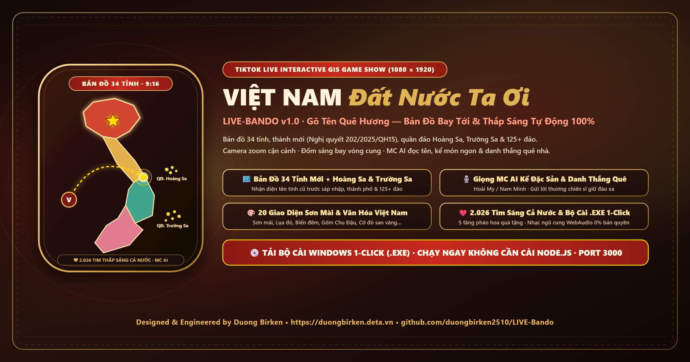
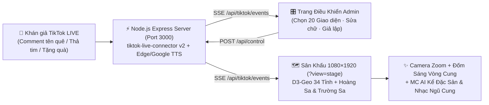
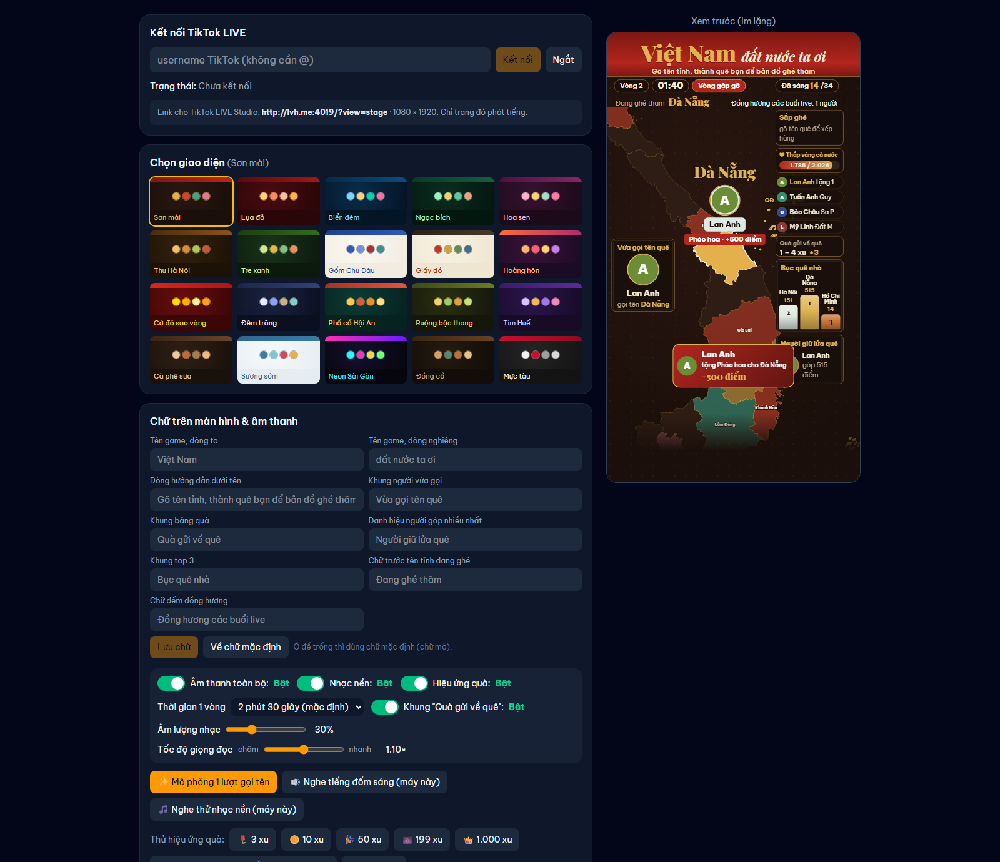
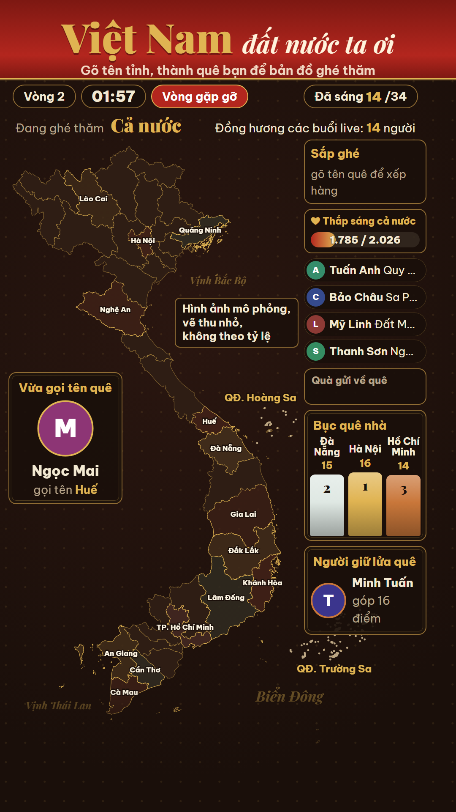
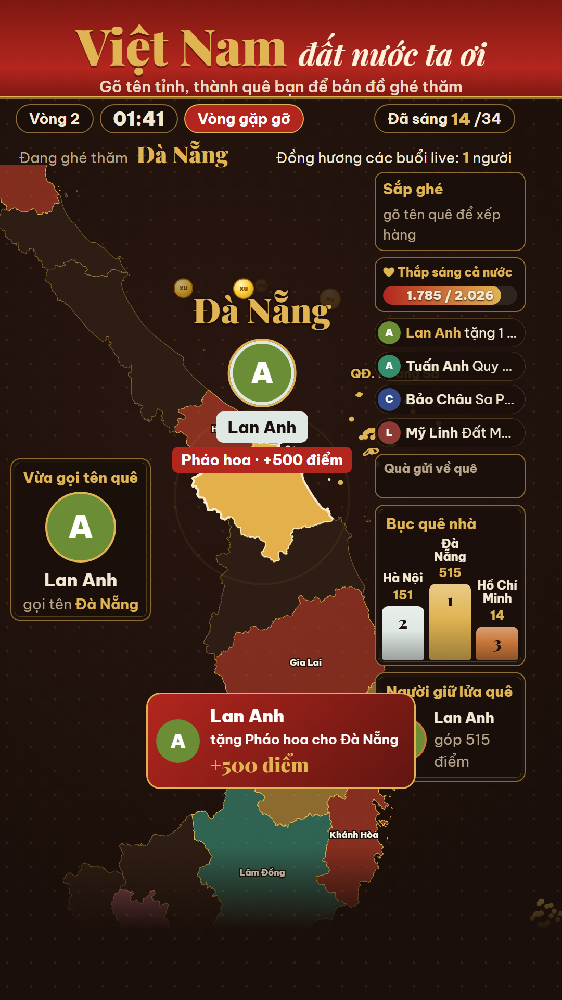
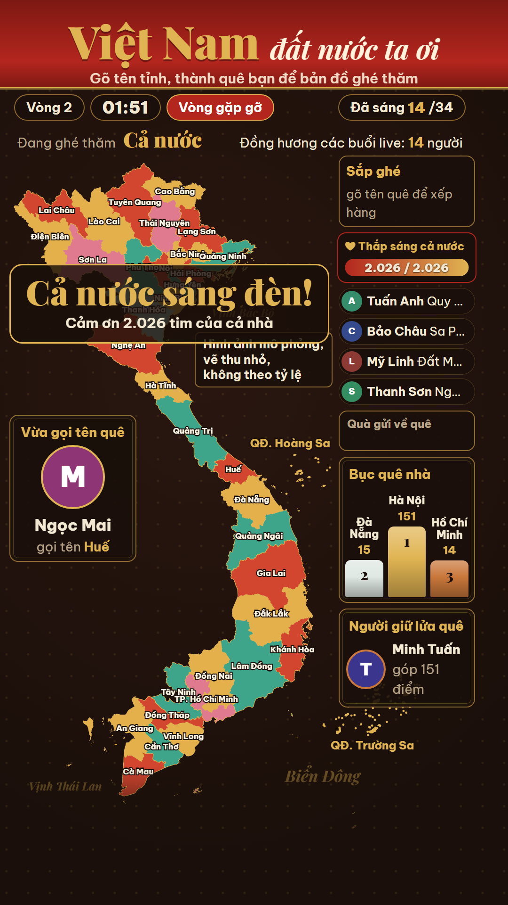
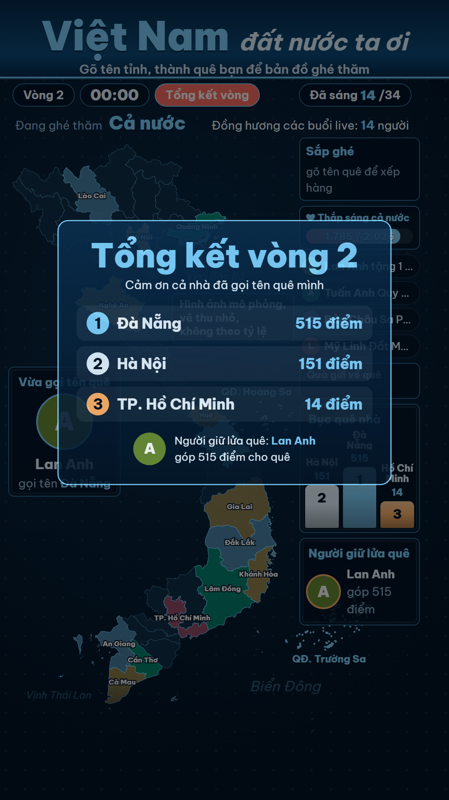
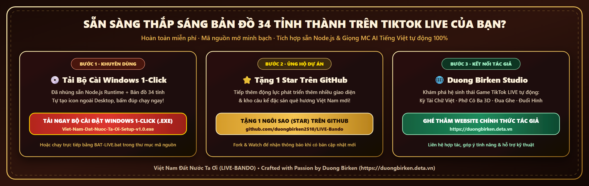

# 🗺️ HỒ SƠ GIỚI THIỆU SẢN PHẨM & CÔNG NGHỆ: VIỆT NAM ĐẤT NƯỚC TA ƠI — LIVE-BANDO (v1.0.0)

  
    
  <h3>
    💿 👉 <a href="https://github.com/duongbirken2510/LIVE-Bando/releases/latest/download/Viet-Nam-Dat-Nuoc-Ta-Oi-Setup-v1.0.exe"><b>[TẢI NGAY BỘ CÀI ĐẶT WINDOWS 1-CLICK: Viet-Nam-Dat-Nuoc-Ta-Oi-Setup-v1.0.exe]</b></a> 👈
  </h3>
  
<i>(Tích hợp sẵn Node.js Runtime + Bản đồ 34 Tỉnh Thành &amp; Hoàng Sa - Trường Sa + 20 Giao Diện Sơn Mài + Giọng MC AI — Tải về nhấp đúp là tự tạo icon Desktop và chạy ngay!)</i>

> **Khẩu hiệu (Tagline):** *"Gõ Tên Tỉnh Thành Quê Hương — Bản Đồ Việt Nam 34 Tỉnh & Biển Đảo Bay Tới, Thắp Sáng & Kể Chuyện Đặc Sản Quê Nhà Tự Động 100% Cho TikTok LIVE"*  
> **Nền tảng hỗ trợ:** Windows 10/11 · macOS · Linux (Node.js + Express + React 19 + D3-Geo + Motion + TikTok LIVE Studio / OBS `1080 × 1920`)  
> **Cổng vận hành mặc định:** `http://localhost:3000` (Trang điều khiển Admin) · `http://lvh.me:3000/?view=stage` (Sân khấu TikTok LIVE Studio `1080 × 1920`)  
> **Tác giả & Website chính thức:** **Duong Birken** — [https://duongbirken.deta.vn](https://duongbirken.deta.vn)  
> **Kho mã nguồn & Tải về:** [https://github.com/duongbirken2510/LIVE-Bando](https://github.com/duongbirken2510/LIVE-Bando)  
> **Bộ cài đặt Windows 1-Click (`.EXE`):** [`Viet-Nam-Dat-Nuoc-Ta-Oi-Setup-v1.0.exe`](https://github.com/duongbirken2510/LIVE-Bando/releases/latest/download/Viet-Nam-Dat-Nuoc-Ta-Oi-Setup-v1.0.exe) · [`../DOWNLOAD_APP.md`](../DOWNLOAD_APP.md)  
> **Cẩm nang Hướng dẫn Sử dụng A–Z (VI/EN):** [`../docs/USER_GUIDE.md`](../docs/USER_GUIDE.md)

---

## 📑 Mục Lục Nhanh
1. [Việt Nam Đất Nước Ta Ơi (`LIVE-BANDO`) là gì?](#1-việt-nam-đất-nước-ta-ơi-live-bando-là-gì)
2. [Các Tính Năng Chính Cung Cấp Cho Người Dùng](#2-các-tính-năng-chính-cung-cấp-cho-người-dùng)
3. [Lợi Ích Mang Lại — Giải Quyết Triệt Để Những "Nỗi Đau" Gì?](#3-lợi-ích-mang-lại--giải-quyết-triệt-để-những-nỗi-đau-gì)
4. [Kịch Bản Thực Tế: Một Phiên Livestream Tiêu Biểu (`A Day in the Life`)](#4-kịch-bản-thực-tế-một-phiên-livestream-tiêu-biểu-a-day-in-the-life)
5. [Kỹ Thuật & Công Nghệ Chuyên Sâu Bên Dưới](#5-kỹ-thuật--công-nghệ-chuyên-sâu-bên-dưới)
6. [Hiệu Quả Công Nghệ & Trải Nghiệm Người Dùng](#6-hiệu-quả-công-nghệ--trải-nghiệm-người-dùng)
7. [Lưu Ý Pháp Lý Bản Đồ Mô Phỏng, An Toàn Chính Sách & Bảo Mật](#7-lưu-ý-pháp-lý-bản-đồ-mô-phỏng-an-toàn-chính-sách--bảo-mật)
8. [Kiến Trúc Hệ Thống & Thư Viện Hình Ảnh Giao Diện Thực Tế](#8-kiến-trúc-hệ-thống--thư-viện-hình-ảnh-giao-diện-thực-tế)
9. [Cấu Hình Yêu Cầu, Bảng Cổng API & Câu Hỏi Thường Gặp (FAQ)](#9-cấu-hình-yêu-cầu-bảng-cổng-api--câu-hỏi-thường-gặp-faq)
10. [Lộ Trình Phát Triển Tiếp Theo, Kêu Gọi Hành Động (CTA) & Liên Hệ Tác Giả](#10-lộ-trình-phát-triển-tiếp-theo-kêu-gọi-hành-động-cta--liên-hệ-tác-giả)

---

## 1. Việt Nam Đất Nước Ta Ơi (`LIVE-BANDO`) là gì?

**Việt Nam Đất Nước Ta Ơi (`LIVE-BANDO`)** là hệ thống **Game Bản Đồ Địa Lý & Văn Hóa Quê Hương Việt Nam Tương Tác Thời Gian Thực** dành riêng cho các buổi phát sóng **TikTok LIVE** khung dọc `1080 × 1920` (`9:16`), được phát triển và hoàn thiện bởi **Duong Birken** ([https://duongbirken.deta.vn](https://duongbirken.deta.vn)).

Khán giả xem phiên livestream chỉ cần **gõ tên tỉnh, thành phố hoặc hòn đảo quê mình vào khung bình luận TikTok**:
- **Bản đồ chữ S 34 tỉnh, thành mới (từ 2025)** lập tức bay camera cận cảnh tới tỉnh hoặc đảo đó.
- Một **đốm sáng vàng lấp lánh** bay theo quỹ đạo vòng cung từ Avatar của người gọi vào đúng tâm tỉnh, làm tỉnh bừng sáng rực rỡ trên nền tranh sơn mài truyền thống, đồng thời dựng cột **ghim Avatar + tên người xem + điểm cộng** ngay trên mảnh đất quê hương.
- **Giọng MC AI tiếng Việt** (*Hoài My* hoặc *Nam Minh*) xướng tên khán giả, giới thiệu **1–2 món đặc sản trứ danh, danh lam thắng cảnh** và lời khen ấm áp về con người vùng đất ấy — hoặc gửi lời thăm hỏi đầy xúc động tới các chiến sĩ đang làm nhiệm vụ nơi hải đảo xa xôi khi khán giả gọi tên **Hoàng Sa, Trường Sa**.

---

## 2. Các Tính Năng Chính Cung Cấp Cho Người Dùng

| Nhóm tính năng | Chi tiết trải nghiệm cung cấp cho người dùng |
| :--- | :--- |
| **1. Bản Đồ 34 Tỉnh Thành Mới (2025) & Đầy Đủ Hoàng Sa – Trường Sa – 125+ Đảo** | • Dữ liệu bản đồ GeoJSON [`public/vn34.json`](../public/vn34.json) cập nhật chuẩn **34 tỉnh, thành phố** theo Nghị quyết 202/2025/QH15. • Hiển thị trang trọng **Quần đảo Hoàng Sa** (thuộc TP. Đà Nẵng), **Quần đảo Trường Sa** (thuộc tỉnh Khánh Hòa), nhãn **Biển Đông · Vịnh Bắc Bộ · Vịnh Thái Lan** và hơn **125 đảo ven bờ** (*Phú Quốc, Côn Đảo, Cát Bà, Lý Sơn, Cô Tô, Bạch Long Vĩ, Phú Quý, Hòn Khoai...*). • Nhận diện thông minh cả **tên tỉnh cũ trước sáp nhập** (*Kiên Giang, Hải Dương, Thái Bình, Bình Dương, Bà Rịa - Vũng Tàu, Quảng Nam, Phú Yên, Bình Định...*), **tên thành phố thuộc tỉnh** (*Hạ Long, Nha Trang, Đà Lạt, Sa Pa, Hội An, Vũng Tàu, Buôn Ma Thuột...*), chữ không dấu, viết tắt (*HN, SG, HCM, BMT*) và chữ gõ dính liền (*thanhhoa, danang, halong*). |
| **2. Camera Zoom Mượt (`d3-interpolate`) & Đốm Sáng Bay Vòng Cung** | • Khi tới lượt ghé thăm, hàm `interpolateZoom` trong [`VietnamMap.tsx`](../src/game/VietnamMap.tsx) tính toán đường bay mượt mà từ toàn cảnh đất nước vào cận cảnh tỉnh/đảo. • Ngay khi camera dừng, hiệu ứng [`Spark`](../src/game/GameStage.tsx) bắn đốm sáng kéo theo 3 đuôi sao bay vòng cung (`750ms`) từ khung *"Vừa gọi tên quê"* vào tâm tỉnh kèm âm thanh vút chuông ngân và tiếng xu *"ting ting"*. |
| **3. MC AI Kể Đặc Sản, Danh Thắng & Lời Thương Gửi Chiến Sĩ Giữ Đảo** | • Cơ sở dữ liệu văn hóa [`src/game/provinceTalk.ts`](../src/game/provinceTalk.ts) tổng hợp đầy đủ món ngon, danh thắng và tính cách con người của cả 34 tỉnh thành (đã gộp đầy đủ đặc sản các tỉnh cũ sáp nhập). • Khi gọi tên các đảo thuộc **Hoàng Sa, Trường Sa** (*Sinh Tồn, Song Tử Tây, Trường Sa Lớn, An Bang, Lý Sơn, Bạch Long Vĩ...*), MC luôn gửi lời thương tới các anh chiến sĩ đang giữ đảo xa nhà. • Tự động rút gọn lời kể khi phòng đông (`talkWhenQueueBelow: 3`) để không làm nghẽn hàng chờ gọi tên. |
| **4. 20 Giao Diện Sơn Mài & Mỹ Thuật Văn Hóa Việt Nam** | • 20 bảng màu nghệ thuật trong [`src/game/themes.ts`](../src/game/themes.ts): *Sơn mài (mặc định), Lụa đỏ, Biển đêm, Ngọc bích, Hoa sen, Thu Hà Nội, Tre xanh, Gốm Chu Đậu, Giấy dó, Hoàng hôn, Cờ đỏ sao vàng, Đêm trăng, Phố cổ Hội An, Ruộng bậc thang, Tím Huế, Cà phê sữa, Sương sớm, Neon Sài Gòn, Đồng cổ, Mực tàu*. • Đổi giao diện bằng 1 cú nhấp chuột trên trang Admin, đồng bộ tức thì sang màn hình TikTok LIVE Studio và tự lưu vào `settings.json`. |
| **5. Thanh Tim Chung `2.026 Tim — Cả Nước Sáng Đèn!` & 5 Tầng Quà Tặng** | • Mọi lượt thả tim trong phòng đều gom vào thanh **❤ Thắp sáng cả nước**: cứ đủ **2.026 tim**, toàn bộ 34 tỉnh thành bừng sáng tuần tự từ Bắc vào Nam trong 5 giây kèm bản hòa âm ngũ cung [`playCelebrate()`](../src/game/sfx.ts). • 5 tầng hiệu ứng quà tặng [`GiftFx.tsx`](../src/game/GiftFx.tsx): `1–4 xu` (+3đ, đốm sáng) · `5–29 xu` (+30đ, mưa xu) · `30–99 xu` (+100đ, mưa xu dày + băng rôn + ưu tiên chen lên đầu hàng) · `100–999 xu` (+500đ, pháo hoa trên tỉnh) · `Từ 1.000 xu` (+3.000đ, đại tiệc pháo hoa toàn màn hình + kèn fanfare). • Cơ chế **cộng bù xu thông minh (`pendingXu`)**: khán giả tặng quà khi chưa kịp gõ tên quê thì số xu vẫn được giữ nguyên qua các vòng, gõ tên quê lúc nào được cộng bù điểm ngay lúc đó! |
| **6. Đếm Đồng Hương Các Buổi Live & Bục Quê Nhà Top 3** | • Mỗi vòng kéo dài `2 phút 30 giây` (tùy chỉnh được từ `1` đến `10 phút`), kết thúc bằng `15 giây Tổng kết vòng` vinh danh Top 3 trên **Bục quê nhà** (cột `2 - 1 - 3`) và danh hiệu **Người giữ lửa quê** (MVP góp nhiều điểm nhất). • Bộ đếm **Đồng hương các buổi live** (`localStorage` key `vndnto:fans`) lưu tích lũy số tài khoản duy nhất từng gọi tên mỗi tỉnh qua mọi buổi phát sóng. |
| **7. Bộ Lọc Từ Tục 3 Lớp & Nhận Diện Lời Cầu Chúc 7 Chủ Đề** | • MC **không bao giờ đọc nguyên văn bình luận tự do** của người xem để tránh rủi ro vi phạm tiêu chuẩn cộng đồng. • Tuy nhiên, bộ nhận diện [`detectWish()`](../src/live/chatter.ts) hiểu được lời cầu chúc trong bình luận theo 7 chủ đề (*Thi cử, Sức khỏe, Tình duyên, Gia đình, Công việc, Tài lộc, Bình an*) để MC gửi lời chúc ấm áp đúng tên người xem. |
| **8. Bàn Điều Khiển Admin Trực Quan & Giả Lập Live Tự Động (10/50/100 Người)** | • Chỉnh toàn bộ 9 nhãn chữ hiển thị trên màn hình, tốc độ giọng đọc (`0.7× – 1.5×`), âm lượng nhạc nền ngũ cung 116 BPM ngay bằng chuột. • Tích hợp khung **Giả lập & Live tự động** chạy trọn 1 vòng với `10`, `50` hoặc `100` người chơi ảo để chủ kênh kiểm tra hiệu ứng trước khi lên sóng. |

---

## 3. Lợi Ích Mang Lại — Giải Quyết Triệt Để Những "Nỗi Đau" Gì?

1. **Giải quyết nỗi đau "Người xem vào phòng không biết bình luận gì và thoát ra sau vài giây":**
   - *Nỗi đau thực tế:* Tâm lý tự hào quê hương luôn là chủ đề dễ kích thích tương tác nhất trên mạng xã hội Việt Nam, nhưng các màn hình live thông thường không có phản hồi thị giác và thính giác tức thì khi khán giả gõ tên quê.
   - *Giải pháp của LIVE-BANDO:* Ngay khi gõ tên tỉnh/đảo, khán giả thấy tên mình trên dải *"Sắp ghé"*, camera bay thẳng tới quê mình, đốm sáng bay ra từ Avatar của chính mình và nghe MC giới thiệu món ngon quê nhà kèm bảng xếp hạng **Bục quê nhà** tạo hiệu ứng rủ đồng hương vào kéo top cực mạnh.
2. **Giải quyết nỗi đau "Tranh cãi về tên tỉnh mới sáp nhập 2025 vs. tên tỉnh cũ quen thuộc":**
   - *Nỗi đau thực tế:* Từ năm 2025 với phương án 34 tỉnh thành mới, nhiều khán giả vẫn quen gõ tên tỉnh cũ (*Kiên Giang, Thái Bình, Hải Dương, Bình Dương, Quảng Nam...*) hoặc tên thành phố/đảo (*Đà Lạt, Nha Trang, Hạ Long, Phú Quốc, Côn Đảo*). Nếu game chỉ nhận 34 tên mới thì hàng loạt người xem sẽ cảm thấy quê mình bị bỏ sót.
   - *Giải pháp của LIVE-BANDO:* Bộ phân giải [`findProvince()` & `findSpot()`](../src/game/provinces.ts) ánh xạ chuẩn xác mọi tên tỉnh cũ, thành phố trực thuộc và hơn 125 đảo về đúng đơn vị tỉnh mới; riêng thành phố/đảo còn được camera zoom đúng tọa độ kinh độ – vĩ độ và MC đọc rõ *"Đà Lạt thuộc tỉnh Lâm Đồng"*, *"Đảo Phú Quốc của tỉnh An Giang"*.
3. **Giải quyết nỗi đau "Gõ câu trò chuyện thông thường bị nhận nhầm thành tên tỉnh/đảo":**
   - *Nỗi đau thực tế:* Nếu bỏ dấu toàn bộ trước khi so khớp, câu *"cảm ơn chị Huệ"* sẽ bị nhận nhầm thành **Huế**, *"nhiều hơn là ít"* nhầm thành đảo **Hòn La**, *"còn có mình"* nhầm thành đảo **Cồn Cỏ**, *"lên đảo chơi"* nhầm thành đảo **Len Đao**.
   - *Giải pháp của LIVE-BANDO:* Thuật toán **Xét Dấu Trước – Không Dấu Sau** trong [`src/game/provinces.ts`](../src/game/provinces.ts) kiểm tra các từ dễ trùng (`STRICT_ACCENT`, `PLAIN_REJECT_IF_ACCENTED`) và yêu cầu tiền tố `"đảo "` với những tên đảo trùng danh từ thông dụng, vượt qua 85 bài test câu tiếng Việt tự nhiên với độ chính xác tuyệt đối.
4. **Giải quyết nỗi đau "Phòng đông 500 người comment cùng lúc làm treo màn hình hoặc kẹt giọng MC":**
   - *Nỗi đau thực tế:* Khi hàng trăm bình luận đổ về mỗi giây, nếu mỗi bình luận đều xếp hàng bay camera và đọc 15 giây đặc sản thì người xem sau phải chờ cả tiếng đồng hồ.
   - *Giải pháp của LIVE-BANDO:* Hàng chờ ghé thăm giới hạn tối đa `6 tỉnh` (quà từ 30 xu được ưu tiên chen lên đầu); nếu nhiều người cùng gọi một tỉnh đang chờ trong hàng, hệ thống tự động gộp thành *"Bạn A với 49 người nữa đang gọi Hà Nội"* và cộng điểm cho tất cả; đồng thời khi hàng chờ `>= 3 tỉnh`, MC tự động chuyển sang chế độ gọi tên nhanh không kể chuyện dài.

---

## 4. Kịch Bản Thực Tế: Một Phiên Livestream Tiêu Biểu (`A Day in the Life`)

| Thời điểm / Bước | Tình huống thực tế của Chủ kênh (Host) | Cách `LIVE-BANDO` phản hồi thông minh |
| :--- | :--- | :--- |
| **Bước 1: Mở game 1-Click (5 giây)** | Chủ kênh nhấp đúp biểu tượng **`Việt Nam Đất Nước Ta Ơi - TikTok LIVE`** ngoài Desktop (hoặc file `BAT-LIVE.bat`). | Server khởi động trên cổng `3000` (nếu bận tự động dò cổng trống kế tiếp `3001..3019`), mở trang điều khiển Admin `http://localhost:3000`. |
| **Bước 2: Chọn giao diện & Lên sóng** | Chủ kênh gắn nguồn Link `http://lvh.me:3000/?view=stage` (`1080 × 1920`) vào TikTok LIVE Studio, chọn giao diện **Sơn mài** hoặc **Cờ đỏ sao vàng**, nhập `@username` và bấm **Kết nối**. | Hệ thống kiểm tra tài khoản đã mở live chưa (`fetchIsLive()`), kết nối Webcast Proto v3, đồng bộ mắt xem, lượt tim, bình luận, quà tặng và khóa chống đè 2 giọng đọc (`announceSpeaker`). |
| **Bước 3: Cao trào gọi tên quê & Thắp sáng cả nước** | Hàng trăm khán giả gõ tên tỉnh/đảo, thả tim và tặng quà kéo quê hương lên Top 3 Bục quê nhà. | Camera bay liên hoàn giữa các tỉnh, đốm sáng bay vòng cung, tỉnh nào nhiều điểm càng sáng đậm (`heat`); khi thanh tim chạm mốc **2.026 tim**, cả 34 tỉnh bừng sáng từ Bắc vào Nam kèm nhạc mừng. |
| **Bước 4: Tổng kết vòng & Xoay vòng tự động** | Đồng hồ đếm ngược 10 giây cuối nháy lớn *"Còn N giây, quê nào vượt lên?"* rồi về `00:00`. | Bảng **Tổng kết vòng** hiện Top 3 quê hương và vinh danh **Người giữ lửa quê** trong 15 giây (quà tặng trong lúc tổng kết vẫn được giữ sang vòng mới), sau đó tự động bước sang vòng kế tiếp. |

---

## 5. Kỹ Thuật & Công Nghệ Chuyên Sâu Bên Dưới

### 5.1. Pipeline Bản Đồ GeoJSON 34 Tỉnh, Sửa Chiều Đa Giác & Quần Đảo Thu Gọn (`src/game/VietnamMap.tsx`, `tools/prep-map.mjs`)
- **Sửa chiều vòng đa giác (`fixWinding`):** Chuẩn RFC 7946 GeoJSON quy định vòng ngoài ngược chiều kim đồng hồ, trong khi `d3-geo` tính diện tích cầu theo chiều kim đồng hồ (nếu ngược chiều sẽ hiểu nhầm thành cả bề mặt Trái Đất trừ tỉnh đó). Hàm `fixWinding(f)` kiểm tra `geoArea(poly) > 2 * Math.PI` để đảo chiều tọa độ chuẩn xác trước khi chiếu Mercator.
- **Bố cục chữ S tối ưu cho màn hình dọc `1080 × 1920`:** Bản đồ đất liền được căn sát lề trái (`MAP_W = 1080, MAP_H = 1470`), đặt tâm zoom tại `FOCUS_X = 505, FOCUS_W = 420` để khi phóng to tỉnh luôn nằm chính giữa khoảng trống giữa thẻ *"Vừa gọi tên quê"* (bên trái – vùng Lào) và cột bảng xếp hạng bên phải (`x >= 720`), đồng thời né hoàn toàn vùng khung chat TikTok ở góc dưới bên trái.
- **Hiển thị Hoàng Sa & Trường Sa trên bản đồ chính (`onMain`):** Vì khoảng cách địa lý thực tế ngoài Biển Đông rất xa bờ (nếu vẽ nguyên tỷ lệ sẽ làm đất liền bị thu nhỏ), hàm `shapes()` chiếu riêng từng cụm đảo Hoàng Sa (ngoài khơi Đà Nẵng) và Trường Sa (ngoài khơi Khánh Hòa) vào khung thu gọn chuẩn hình dáng quần đảo, cho phép camera zoom thẳng vào từng đảo nhỏ và cắm ghim theo đúng tọa độ `(lon, lat)`.

### 5.2. Thuật Toán Nhận Diện Tỉnh/Đảo "Xét Dấu Trước – Không Dấu Sau" (`src/game/provinces.ts`)
- Hàm `findProvince(comment)` và `findSpot(comment)` thực hiện quy trình 3 tầng:
  1. Kiểm tra trên văn bản giữ nguyên dấu thanh tiếng Việt (`withAccents`) để loại trừ các cụm từ giao tiếp thông thường như *"chị Huệ / em Huệ / cô Huệ"*, *"hơn là"*, *"còn có"*, *"lên đảo"* (`PLAIN_REJECT_IF_ACCENTED`).
  2. Chuyển sang chuỗi chuẩn hóa không dấu (`plain`), ưu tiên khớp các địa danh có độ dài từ khóa lớn nhất trước (`BY_LEN`) để tránh khớp nhầm từ ngắn nằm trong từ dài.
  3. Hỗ trợ khớp chuỗi gõ dính liền không khoảng trắng (`compact`: `thanhhoa` → `Thanh Hóa`, `halong` → `Hạ Long`, `baoloc` → `Bảo Lộc`) đối với các từ khóa có độ dài `>= 5` ký tự.

### 5.3. Đồng Hồ Vòng Đồng Bộ Theo Giờ Máy & Hàng Chờ Ghé Thăm Ưu Tiên (`src/game/useGame.ts`)
- Hàm [`roundClock(now)`](../src/game/useGame.ts) tính pha hiện tại (`open` 15s → `play` → `summary` 15s) dựa trên phép chia lấy dư `(now + clockOffset) % CYCLE`, giúp trang điều khiển Admin và mọi tab Stage luôn khớp nhau tới từng mili-giây mà không cần bắn gói tin đồng hồ mỗi giây.
- Hàng chờ `enqueue(v)` phân tách bình luận thường và quà tặng ưu tiên (`pri: coins >= 30`): quà lớn được chèn ngay lên đầu hàng chờ (`g.queue.splice`), trong khi bình luận trùng tỉnh đang đợi sẽ tự động tăng bộ đếm `same.others++`.

### 5.4. Nhạc Nền Ngũ Cung 116 BPM Tự Tổng Hợp & Hàng Đợi Giọng Đọc An Toàn (`src/game/music.ts`, `src/game/sfx.ts`, `src/live/voice.ts`)
- **100% Procedural WebAudio:** [`src/game/music.ts`](../src/game/music.ts) tự tổng hợp giai điệu ngũ cung Việt Nam (*Rê – Mi – Sol – La – Si*, `SCALE = [293.66, 329.63, 392.0, 440.0, 493.88, 587.33, 659.25]`) cùng bass, trống trầm và hi-hat ở nhịp `116 BPM` — hoàn toàn không dùng file nhạc ngoài nên **0% rủi ro bản quyền TikTok**. Khi MC đọc (`voice.busy`), `master.gain.setTargetAtTime` tự động hạ nhạc nền xuống `35%`.
- **Hàng đợi giọng đọc chống treo (`playSafe` & `edgeTts`):** Trong [`server.ts`](../server.ts), luồng `MsEdgeTTS` được bọc `read.catch(() => {})` và `Promise.race` timeout 20s để ngăn lỗi `UnhandledPromiseRejection` khi mạng chập chờn, tự động chuyển sang Google TTS dự phòng và lưu cache LRU 200 câu thoại. Ở phía trình duyệt, `playSafe()` đặt chốt chặn `START_TIMEOUT_MS = 8000` và `OVERRUN_MS = 4000` để một câu âm thanh lỗi không bao giờ làm kẹt giọng MC suốt buổi live.

---

## 6. Hiệu Quả Công Nghệ & Trải Nghiệm Người Dùng

| Tiêu chí đánh giá | Game bản đồ livestream thông thường | Hiệu quả thực tế trên **Việt Nam Đất Nước Ta Ơi (`LIVE-BANDO`)** |
| :--- | :--- | :--- |
| **Độ chính xác bản đồ & biển đảo** | Bản đồ 63 tỉnh cũ hoặc thiếu đảo nhỏ, thiếu Hoàng Sa / Trường Sa | **Chuẩn 34 tỉnh thành mới (2025) + Quần đảo Hoàng Sa, Trường Sa & 125+ đảo, nhận cả tên tỉnh cũ trước sáp nhập** |
| **Nhận diện ngôn ngữ tự nhiên** | Bỏ dấu đơn giản, dễ nhận nhầm *"chị Huệ"* thành *Huế* | **Thuật toán Xét Dấu Trước + hỗ trợ gõ tắt, không dấu, gõ dính liền (`thanhhoa`, `danang`), vượt qua 85 câu test** |
| **Chiều sâu văn hóa & cảm xúc** | Chỉ đọc tên tỉnh khô khan | **MC kể món ngon, danh thắng từng vùng và gửi lời thương tới các chiến sĩ đang giữ đảo Hoàng Sa – Trường Sa** |
| **Tùy biến thẩm mỹ sân khấu** | 1 giao diện cố định | **20 giao diện mỹ thuật Việt Nam (*Sơn mài, Lụa đỏ, Gốm Chu Đậu, Giấy dó, Cờ đỏ sao vàng...*) đổi tức thì 1 chạm** |
| **Âm thanh & Bản quyền** | Dùng file MP3 dễ bị TikTok tắt tiếng vì bản quyền | **100% WebAudio tự tổng hợp nhạc ngũ cung 116 BPM & hiệu ứng đốm sáng / pháo hoa 5 tầng, tự hạ nhạc khi MC nói** |

---

## 7. Lưu Ý Pháp Lý Bản Đồ Mô Phỏng, An Toàn Chính Sách & Bảo Mật

1. **Minh bạch về Bản đồ Mô phỏng (`Map Simulation Disclaimer`):**
   - Để hiển thị rõ nét trên khung hình dọc `1080 × 1920` của điện thoại, hai quần đảo **Hoàng Sa** và **Trường Sa** được vẽ thu nhỏ và đặt gần bờ hơn thực tế; ranh giới 34 tỉnh thành được rút gọn từ bộ dữ liệu GIS cộng đồng.
   - Trên màn hình sân khấu luôn hiển thị rõ dòng chữ **"Hình ảnh mô phỏng, vẽ thu nhỏ, không theo tỷ lệ"** (tại khu vực Vịnh Bắc Bộ khi nhìn toàn cảnh) đúng tinh thần minh bạch pháp lý.
2. **Tuân thủ chính sách TikTok LIVE & Pháp luật hiện hành:**
   - **Không dùng game để trao thưởng tiền/hiện vật:** Game chỉ cộng điểm vinh danh quê hương trên bảng xếp hạng vui mỗi vòng `2 phút 30 giây`, không có cơ chế cá cược hay trả thưởng.
   - **Bộ lọc từ tục 3 lớp (`src/live/bannedWords.ts`):** Chặn tên nhạy cảm (`isRudeName`), che `***` trên dòng chạy bình luận (`maskBanned`), không bao giờ đọc nguyên văn comment tự do và có chốt chặn cuối trong `voice.say()` (câu chứa từ cấm sẽ bị hủy ngay).
3. **Bảo mật máy chủ cục bộ (`DNS Rebinding & Localhost Guard`):**
   - Server chỉ lắng nghe trên `127.0.0.1` (`listenFree`) và kiểm tra nghiêm ngặt header `Host` / `Origin` thuộc tập `['localhost', '127.0.0.1', 'lvh.me']`, đồng thời tự động phân xử loa (`announceSpeaker`) để chỉ duy nhất 1 tab Stage mở sau cùng được phát tiếng.

---

## 8. Kiến Trúc Hệ Thống & Thư Viện Hình Ảnh Giao Diện Thực Tế

### 8.1. Toàn Cảnh Trang Điều Khiển Quản Trị Admin & Khung Xem Trước Sân Khấu (`http://localhost:3000`)

### 8.2. Thư Viện Hình Ảnh Sân Khấu `1080 × 1920` Thực Tế Trên TikTok LIVE Studio

| 🗺️ **Giao Diện Sơn Mài Toàn Cảnh 34 Tỉnh & Biển Đảo** | 📍 **Camera Zoom Cận Cảnh, Đốm Sáng & Ghim Quê Hương** |
| :---: | :---: |
|  |  |
| ❤️ **Khoảnh Khắc 2.026 Tim — Cả Nước Sáng Đèn!** | 🌙 **Giao Diện Biển Đêm & Bảng Tổng Kết Vòng Top 3** |
|  |  |

---

## 9. Cấu Hình Yêu Cầu, Bảng Cổng API & Câu Hỏi Thường Gặp (FAQ)

### 💻 Cấu Hình Yêu Cầu
- **Hệ điều hành:** Windows 10/11 (64-bit), macOS 12+, hoặc Linux.
- **Môi trường:**
  - Nếu dùng **Bộ cài 1-Click [`Viet-Nam-Dat-Nuoc-Ta-Oi-Setup-v1.0.exe`](https://github.com/duongbirken2510/LIVE-Bando/releases/latest)**: **Không cần cài đặt Node.js** (đã nhúng sẵn Node Runtime bên trong).
  - Nếu chạy từ mã nguồn (`BAT-LIVE.bat` / `npm run dev`): Node.js `v18+` (khuyên dùng `v20+` hoặc `v22+` LTS), kết nối mạng Internet để tạo giọng MC AI và phần mềm **TikTok LIVE Studio** hoặc **OBS Studio**.

### 🔌 Bảng Cổng HTTP / SSE API (`Port 3000`)

| Endpoint (`Port 3000`) | Phương thức | Chức năng |
| :--- | :---: | :--- |
| `/` | `GET` | Giao diện Trang điều khiển Admin + Bảng chọn 20 giao diện + Khung xem trước Stage `9:16` |
| `/?view=stage` | `GET` | Màn hình Sân khấu độc lập `1080 × 1920` gắn vào nguồn Link của TikTok LIVE Studio / OBS |
| `/api/tiktok/events` | `GET (SSE)` | Luồng sự kiện thời gian thực (`status`, `speaker`, `chat`, `gift`, `like`, `member`, `follow`, `control`) |
| `/api/tiktok/status` | `GET` | Truy vấn trạng thái kết nối phòng live, số mắt xem, tổng tim và số tab Stage đang mở |
| `/api/tiktok/connect` & `/disconnect` | `POST` | Kiểm tra `fetchIsLive()` và kết nối / ngắt kết nối trực tiếp phòng TikTok LIVE qua `@username` |
| `/api/control` | `POST` | Đồng bộ lệnh điều khiển (`setTheme`, `setPrefs`, `setName`, `setVoice`, `setRate`, `speak`, `reset`, `custom`) và lưu vào `settings.json` |
| `/api/tts` | `GET` | Tổng hợp giọng đọc tiếng Việt `MsEdgeTTS` (*Hoài My / Nam Minh*) kèm tự động chuyển đổi dự phòng sang `Google TTS` và bộ nhớ đệm 200 câu |
| `/api/test/emit` | `POST` | Giả lập sự kiện `chat`, `gift`, `like`, `member`, `follow`, `share` để thử nghiệm ngay khi chưa bật Live |
| `/api/server/shutdown` | `POST` | Đóng kết nối TikTok LIVE, ngắt luồng SSE và giải phóng hoàn toàn cổng `3000` |

### ❓ Câu Hỏi Thường Gặp (FAQ)
- **Hỏi: Vì sao nên dán link `http://lvh.me:3000/?view=stage` vào TikTok LIVE Studio thay vì `localhost`?**
  - *Đáp:* Một số phiên bản TikTok LIVE Studio chặn từ khóa `localhost` trong nguồn Link. Tên miền `lvh.me` luôn phân giải trực tiếp về `127.0.0.1` trên máy tính của bạn nên vượt qua bộ lọc hoàn toàn hợp lệ và không tốn băng thông mạng.
- **Hỏi: Làm sao để tránh nghe 2 giọng MC hoặc 2 lớp nhạc đè nhau?**
  - *Đáp:* Hệ thống đã có cơ chế `announceSpeaker` tự động chỉ cho phép **trang `?view=stage` mở sau cùng** phát tiếng. Khi đã gắn link vào TikTok LIVE Studio, bạn nhớ đóng các tab `?view=stage` mở thử ngoài trình duyệt Chrome/Edge.

---

## 10. Lộ Trình Phát Triển Tiếp Theo, Kêu Gọi Hành Động (CTA) & Liên Hệ Tác Giả

### 🚀 Lộ Trình Các Phiên Bản Tiếp Theo (`Roadmap`)
- Mở rộng kho câu kể chuyện văn hóa `provinceTalk.ts` với các làn điệu dân ca, lễ hội truyền thống và làng nghề đặc trưng của từng vùng.
- Bổ sung chế độ **Bảng Vàng Đồng Hương Tuần / Tháng** lưu trên máy chủ để vinh danh những tỉnh thành có cộng đồng đồng hương đông đảo nhất qua nhiều buổi live.
- Tích hợp thêm bộ công cụ xuất ảnh thẻ vinh danh *"Quê Quán Quân Buổi Live"* để chủ kênh đăng bài cảm ơn sau mỗi phiên phát sóng.

---

### 🎯 Kêu Gọi Hành Động / Call To Action (CTA)

  
    
  <h3>
    💿 <a href="https://github.com/duongbirken2510/LIVE-Bando/releases/latest/download/Viet-Nam-Dat-Nuoc-Ta-Oi-Setup-v1.0.exe"><b>[1. TẢI NGAY BỘ CÀI WINDOWS 1-CLICK (.EXE)]</b></a>
    &nbsp;·&nbsp;
    ⭐ <a href="https://github.com/duongbirken2510/LIVE-Bando"><b>[2. TẶNG 1 STAR TRÊN GITHUB]</b></a>
    &nbsp;·&nbsp;
    🌐 <a href="https://duongbirken.deta.vn"><b>[3. GHÉ THĂM DUONGBIRKEN.DETA.VN]</b></a>
  </h3>

---

### 👨‍💻 Tác Giả & Liên Hệ / Author & Contact

| 🇻🇳 Lời nhắn từ Tác giả | 🇬🇧 Note from the Author |
| :--- | :--- |
| **Việt Nam Đất Nước Ta Ơi (`LIVE-BANDO`)** là dự án tâm huyết được phát triển và đóng gói bởi **Duong Birken** nhằm mang vẻ đẹp bản đồ đất nước, biển đảo quê hương và văn hóa ẩm thực – danh thắng 34 tỉnh thành Việt Nam lên không gian livestream tương tác hiện đại. Nếu dự án hữu ích với bạn, đừng quên **tải bản cài đặt 1-Click trải nghiệm ngay**, tặng một ngôi sao (**⭐ Star**) trên GitHub và ghé thăm website chính thức để kết nối, chia sẻ ý kiến đóng góp nhé! | **Việt Nam Đất Nước Ta Ơi (`LIVE-BANDO`)** is crafted with passion by **Duong Birken** to celebrate Vietnam's geography, islands, regional cuisine, and cultural heritage through real-time interactive livestreaming. If you find this project helpful, please **download the 1-Click installer**, give the repository a **⭐ Star** on GitHub, and visit the official website to connect and explore more interactive livestream tools! |

- **🌐 Website chính thức & Liên hệ tác giả:** [**https://duongbirken.deta.vn**](https://duongbirken.deta.vn)
- **🐙 GitHub Profile:** [**https://github.com/duongbirken2510**](https://github.com/duongbirken2510)
- **📦 Kho mã nguồn GitHub:** [**https://github.com/duongbirken2510/LIVE-Bando**](https://github.com/duongbirken2510/LIVE-Bando)
- **💿 Hướng dẫn Tải & Cài đặt `.EXE` 1-Click:** [**`../DOWNLOAD_APP.md`**](../DOWNLOAD_APP.md)
- **📖 Cẩm nang Hướng dẫn Sử dụng A–Z (`VI / EN`):** [**`../docs/USER_GUIDE.md`**](../docs/USER_GUIDE.md)
- **📄 Trang chủ README dự án:** [**`../README.md`**](../README.md)
